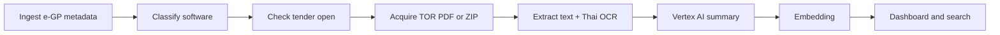

# MoneyTamNgan

Tracks software-related TOR (procurement) projects from Thailand's e-GP portal: it ingests project metadata, downloads and reads the TOR documents (text and Thai OCR), summarises them with Vertex AI, and shows them in a Next.js dashboard with search, matching and analytics. A Bid Preparation Assistant helps sellers prepare bid documents; it never submits a bid.

> **AI provider.** The system is designed to use Gemini on Vertex AI. Gemini called through the `agy` CLI ([agy bridge](docs/agy-bridge.md)) is the **fallback AI provider** for the demo, because Vertex AI has no billing yet; it replaced the local model (Ollama `qwen2.5:3b`), which was too slow. With `AI_PROVIDER=vertex` and `AI_FALLBACK_PROVIDER=ollama` (PR #249), a generation request that Vertex refuses (credentials, HTTP error, quota, network, time-out) is sent once to `OLLAMA_BASE_URL` (the bridge or a local model); embeddings do not fall back. Without PR #249 or without that setting the switch is manual (`AI_PROVIDER`). The bridge is for demos only.


## Software Development Security project (01219325)

### 1. Application name and team members

**MoneyTamNgan** helps software contractors discover Thai procurement opportunities and prepare bid documents. Team roster confirmed on 19 November 2026:

| Team member |
| --- |
| Phruek Chantarasittiphon |
| Watcharapat Pathanutpong |
| Peerawat Theerasakul |
| Napat Sirichan |

The detailed [18-criterion security audit and project report](docs/security-assignment-audit-2026-11-19.md) records the implementation, tests, limitations and submission checklist. It assesses **13 criteria as covered and five as partial**; this is not a claim of complete OWASP ASVS compliance.

### 2. Functional features

- Discover government/e-GP projects, classify software work and assess bidding availability.
- Acquire PDF/ZIP sources, extract embedded text or Thai OCR, and retain document/extraction provenance.
- Use Vertex AI to summarize TORs, identify restrictive conditions, and extract fiscal-year and announcement-schedule evidence.
- Search/filter projects, compare skill matches and view procurement analytics.
- Manage company profiles, bid checklists and saved drafts; export reviewed drafts as DOCX. The app does not submit bids to e-GP.
- Send opted-in threshold notifications and daily digests; provide protected admin review and pipeline controls.

Government availability, anti-bot pages, OCR quality and AI accuracy can limit results. See [pipeline details](docs/pipeline.md). Installation commands remain under [Quick start](#quick-start) and [Run with Docker](#run-with-docker).

### 3. Security features mapped to OWASP ASVS

Mapping uses [OWASP ASVS 5.0.0](https://asvs.owasp.org/). These are selected implemented controls, not an exhaustive Level 1 checklist. [The audit](docs/security-assignment-audit-2026-11-19.md#3-security-features-mapped-to-owasp-asvs-security-requirements) also maps gaps and [OWASP Top 10:2025](https://top10.owasp.org/2025/).

| Security feature | Selected ASVS 5.0.0 reference | Implementation/evidence |
| --- | --- | --- |
| Password signup/login and salted scrypt hashes | `6.2.1`, `11.4.2` | [Password controls](lib/password-auth.js), [auth tests](tests/integration/password-auth.integration.test.js) |
| Google OAuth authorization-code sign-in | Authentication/federation chapters V6/V10; not a claim of complete chapter coverage | [Google callback](app/api/auth/google/callback/route.js), [OAuth tests](tests/integration/google-oauth-security.integration.test.js) |
| Roles/scopes and owner-bound data access | `8.2.1`, `8.2.2`, `8.3.1` | [Authorization](lib/request-authorization.js), [RBAC spec](docs/security/RBAC_SPEC.md), [ownership tests](tests/security/bid-prep-access.test.js) |
| Signed tokens, HS256 allowlist and expiration | `9.1.1`, `9.1.2`, `7.3.2` | [JWT helpers](lib/auth.js), [disabled-account checks](lib/account-status.js) |
| Login/API rate limiting | `6.1.1`, `6.3.1`, `2.4.1` | [Authentication design](docs/security/AUTHENTICATION.md), [rate limiter](lib/rate-limit.js) |
| Exact-origin CORS and browser mutation checks | `3.4.2` | [Origin policy](lib/security-policy.js), [scope/CORS tests](tests/security/scopes-cors-headers.test.js) |
| CSP/HSTS/anti-framing/nosniff/referrer headers | `3.4.1`–`3.4.6` (selected/partial) | [Next config](next.config.js), [Proxy](proxy.js), [live header evidence](docs/evidence/security-assignment-2026-11-19/live-http.json) |
| Server input validation and controlled database queries | `2.1.1`, `2.2.1`, `1.2.4` (partial) | [Input dictionary](docs/API_VALIDATION.md), [profile validation](lib/profile-validation.js) |
| Safe errors and security-event logging | `16.5.1`, `16.3.1` (partial) | [Audit helper](lib/auth-audit.js), [BidPrep security](lib/bid-prep/security.js); legacy gaps remain |

**Four distinct advanced features:** scope-based authorization, login-attempt rate limits, backend API rate limits, and JWT expiration checks. Local MFA/OTP, compromised-password screening and an inactivity timeout are not implemented. Rate counters are process-local; copied JWT revocation on logout remains incomplete.

### 4. Threat modeling

The project uses [STRIDE](docs/security/THREAT_MODEL.md) across browser/API, worker/database, external-document, AI and SMTP trust boundaries. Existing threats include forged sessions, admin escalation, cross-user access, malicious files, SSRF, abusive expensive operations and sensitive-data disclosure.

The [audit's prioritized threat checklist](docs/security-assignment-audit-2026-11-19.md#4-threat-modeling-performed-for-this-project) maps mitigations and residual risks. Its priorities are recommendations awaiting team adoption:

| Priority | Examples | Current state |
| --- | --- | --- |
| P0 | Previously exposed credential lifecycle | Confirm revocation; private configuration alone does not revoke a leaked key. |
| P1 | Authorization/ownership, CSRF, session termination, URL checks, error disclosure and logging | Many controls are tested; logout revocation, URL validation and legacy error/log handling remain partial. |
| P2 | AI-output trust, export misuse and operational hardening | Provenance, escaping and non-submission notices exist; human review remains necessary. |

The report marks incomplete mitigations explicitly. It does not assume every historical “Mitigated” row or external spreadsheet status is fully verified.

### 5. Security principles followed

| Principle | How it appears in the implementation |
| --- | --- |
| Least privilege | Role-bounded scopes; separate pipeline/cron credentials; signup cannot assign an admin role. |
| Complete mediation | Both Proxy and route handlers enforce permissions; private data queries use the signed-in owner. |
| Fail-safe defaults | Invalid sessions, unknown protected mutations and unapproved browser origins are rejected. |
| Defense in depth | Authorization, input checks, origin policy, CSP, quotas and CI scanners provide separate layers. |
| Data minimization | Password hashes are hidden; Vertex payloads and security logs use field allowlists. |
| Resource containment | Password-hash concurrency, bounded auth bodies, archive checks and pipeline leases limit damage. |

Source mappings and exceptions are documented in the [security report](docs/security-assignment-audit-2026-11-19.md#5-security-principles-followed-in-the-implementation).

### 6. Security test process

After configuring the local environment, use locked dependencies and run:

```sh
npm ci
npm test
npm run test:vitest
npm run build
npm run audit:dependencies
node scripts/audit-api-documentation.js
```

Fresh verification on **19 November 2026**, baseline `b053761`: **800 tests passed**, production build passed, and raw npm audit reported zero findings. The documentation audit **failed**: two documents omit the checklist PATCH method; OpenAPI lacks 18 live operations and contains six operations without handlers. Green contract tests do not prove full API coverage.

CI runs Semgrep SAST and an OWASP ZAP passive baseline. Latest same-code evidence has **0 High / 50 Warning SAST findings**, and **0 High / 1 Medium / 3 Low / 4 Informational DAST alerts**. See [saved evidence and test process](docs/security-assignment-audit-2026-11-19.md#6-security-test-process), [scanner workflows/reports](docs/security/README.md) and [vulnerability policy](docs/security/VULNERABILITY_MGMT.md). Passive, unauthenticated DAST does not prove authenticated authorization safety; dedicated ownership/scope tests cover those cases separately.

Live local checks verified five HTTP security headers, per-request CSP nonces, exact-origin preflights and 401/403 denial behavior. The team should show the custom header configuration and DevTools Network response headers during the presentation. This audit did not verify production HTTPS, perform a fresh Google login, send another email or run paid Vertex processing.

**Known gaps:** copied-JWT reuse after logout; inconsistent raw error exposure and auth-event logging; legacy input/regex and URL-validation weaknesses; missing password change/common-password screening; and unconfirmed old-key revocation. Full findings, remediation priorities and the final submission checklist are in the [audit report](docs/security-assignment-audit-2026-11-19.md).

## Documentation

Requirement ids from the main SRS stay `FR-1.x` … `FR-4.2.x` and `NFR-1` … `NFR-6`. The Bid Preparation SRS reuses `FR-4.1` … `FR-4.7` for a different epic, so those ids are written **BidPrep FR-4.x** in this repository. The rule is in [docs/traceability.md](docs/traceability.md#requirement-id-convention).

The in-repo index is [docs/README.md](docs/README.md).

| Document | What it is |
| --- | --- |
| [MoneyTamNgan SRS](https://docs.google.com/document/d/1_o6RmB_G54MWgXHGiePvBzy-vLkhECAzDnhtU15rz0A/edit) | Main SRS: TOR aggregation, matching and public analytics (FR-1.1.1 … FR-4.2.2, NFR-1 … NFR-6) |
| [Bid Prep Ad Hoc SRS](https://docs.google.com/document/d/1rIqJhvAdZuRWVMVB5JdqmpVUwuwbRRzyAZyfrpj0PH4/edit) (Thai) and [SRS adhoc requirement](https://docs.google.com/document/d/1u8PlICl8XWIjGJUca1KImYh5keUNDkgUoAU73ERks8A/edit) (English) | Bid Preparation SRS (epic #135). English copy is waiting for customer confirmation (#143) |
| [Design document](docs/design/README.md) | Index of the design that the code implements: architecture, ER diagram, patterns, pipeline, sequence diagram and API |
| [Traceability matrix](docs/traceability.md) | FR to GitHub card, pull request, test and evidence file, including remaining gaps |
| [ER diagram](docs/audit/02-data-model-er.md) | Data model, classification and unique indexes |
| [Sequence diagram](docs/tor-flow.md) and [source](docs/diagrams/tor-discovery-extraction-display.mmd) | Discovery, extraction and display |
| [Pipeline flowchart](docs/pipeline.md) | Stage-by-stage TOR pull, with statuses and code locations |
| [UI test cases](docs/testing/test-sheet.md) ([csv](docs/testing/test-sheet.csv), [plan](docs/testing/test-plan.md), [evidence index](docs/testing/evidence-index.md)) | 22 Nov browser run, one video and screenshot per step, with an FR column |
| [MoneyTamNgan Testcase doc](https://docs.google.com/spreadsheets/d/1DAK7xXw7uJ3rpTrQNPMUjbzi6WOAh-0dQBn6BTv8dQo/edit?usp=sharing) and [module map](https://docs.google.com/spreadsheets/d/1R6gXlBh75GxtKXlraxE6N0eJU5URTa0pgbbUvg4j3GE/edit?usp=sharing) | Automated-test spreadsheets. The second id is the one recorded in [docs/reference.md](docs/reference.md) |
| [Sprint API plan](https://docs.google.com/spreadsheets/d/1aXUlWRg__PmH6LtbzPxBnOCS7z7v9pk-xxEpwySVCU0/edit?usp=sharing) and [OpenAPI](docs/api/openapi.yaml) | API plan and the contract the routes implement ([overview](docs/api/README.md)) |
| [Security test catalog](https://docs.google.com/spreadsheets/d/1zl9NWZmycvNj0Brg7PMB2kdizVcQq-ihKPNbVODycvY/edit?usp=sharing) and [docs/security/](docs/security/README.md) | STRIDE and ASVS catalog, threat model, authentication, RBAC and BidPrep FR-4.7 |
| [Technical reference](docs/reference.md) | Pipeline, storage, Vertex, AI provider fallback ([agy bridge](docs/agy-bridge.md)), Thai OCR, CI |
| [Security presentation](docs/presentation/moneytamngan-security-en-20slides.pptx) | 20 English slides with speaker notes, ASVS/STRIDE mappings and remaining gaps |

## How a software TOR flows through the system

1. **Discover:** the scheduler or an admin run reads the e-GP feed and stores new projects.
2. **Acquire:** the worker downloads each TOR document (PDF or ZIP).
3. **Extract:** text and OCR, then a Vertex AI summary and embedding.
4. **Display:** the dashboard lists and searches the result; admins can review and override.



Stage details, statuses and failure paths: [docs/pipeline.md](docs/pipeline.md). Actor-by-actor sequence: [docs/tor-flow.md](docs/tor-flow.md).

## Run (Docker only)

**Docker is the only supported way to run this project.** Do not start it with `npm run dev`, `npm start` or `node scripts/...` on the host: the worker needs Chromium, Poppler and Tesseract, and the app expects the compose network. Requirements: Docker with Compose v2. No Node or MongoDB is needed on the host (Python 3 only for the optional smoke test).

```bash
cp .env.example .env                 # set JWT_SECRET (and EGP_API_KEY); see .env.example
docker compose up --build -d         # app :3000, worker, scheduler, local mongo
curl http://localhost:3000/api/health
docker compose ps
docker compose logs -f app worker
docker compose down                  # stop (keeps data); add -v to delete the data
```

Services: `app` (web + API), `worker` (OCR, AI extraction, drafts, emails), `scheduler` (ingestion at 06:00, 12:00 and 18:00 Asia/Bangkok), `scraper` (one-off scrape), `mongo` (local database).

**Fetch and process data now** (instead of waiting for the schedule):

```bash
docker compose run --rm scheduler node scripts/ingestion-scheduler.js --once   # discover and download TORs
docker compose logs -f worker                                                  # watch OCR, extraction, classification
```

AI: set `AI_PROVIDER=ollama` and `OLLAMA_BASE_URL` for a local model, or `VERTEX_AI_ENABLED=true` with Google credentials (see [Vertex AI](docs/reference.md#vertex-ai)). Without either, ingestion and downloads still work but extraction stays pending.

Against Atlas, with the machine's IP allowed automatically (needs `ATLAS_PUBLIC_KEY`, `ATLAS_PRIVATE_KEY`, `ATLAS_PROJECT_ID` in `.env`):

```bash
docker compose -f docker-compose.yml -f docker-compose.atlas.yml up --build -d
```

### Local database vs live database (Atlas)

| | Local | Live (Atlas) |
|---|---|---|
| Command | `docker compose up --build` | `docker compose -f docker-compose.yml -f docker-compose.atlas.yml up --build` |
| Database | bundled `mongo` container, data in the `mongo-data` volume | MongoDB Atlas from `MONGODB_URI` |
| Extra setup | none | machine IP on the Atlas access list (`atlas-allowlist` does it with `ATLAS_*` keys) |
| Data | empty until you ingest | real data; everything you do writes to it |
| Reset | `docker compose down -v` deletes the local data | never reset; check `MONGODB_URI` first |

Keep the `scheduler` service off on a live database unless you want it to ingest at 06:00, 12:00 and 18:00. Open the app at `http://localhost:3000` (the session cookie is `Secure`, so login does not work over plain http by IP).

**Test the demo** after either start:

```bash
curl http://localhost:3000/api/health          # 200, database: connected
python3 tests/e2e/smoke-api.py                 # 32 steps; creates and deletes 2 test accounts
```

Then follow the [BidPrep demo script](docs/demo-script-bidprep.md). The smoke test removes its own accounts, but the AI draft step takes 1 to 2 minutes. On an empty local database the TOR-dependent steps (detail, checklist, draft) return 404 until you ingest data (command above) or use Atlas.

Start, stop and rollback on a demo machine: [docs/local-deployment.md](docs/local-deployment.md).

## Common commands (all through Docker)

| Task | Command |
|---|---|
| Unit, integration and security tests | `docker build --target builder -t moneytamngan-test . && docker run --rm moneytamngan-test sh -c "npm test && npm run test:vitest"` |
| Production build check | `docker compose build app` |
| Create or update MongoDB and Atlas Vector Search indexes | `docker compose run --rm worker npm run db:ensure-indexes` |
| Backfill usernames (dry run; add `-- --apply` to write) | `docker compose run --rm worker npm run db:migrate-users` |
| Make a user an admin | `docker compose run --rm worker npm run user:promote -- <email>` |
| Disable a user (dry run; add `--apply`) | `docker compose run --rm worker npm run user:disable -- --email=<email>` |
| Process queued TOR jobs once | `docker compose logs -f worker` (the `worker` service already runs `--watch`) |
| One scrape run | `docker compose run --rm scraper` |
| Embeddings for semantic search (needs Vertex) | `docker compose run --rm worker npm run embed -- --limit=50` |
| API smoke test (stack must be up) | `python3 tests/e2e/smoke-api.py` (uses only the Python standard library) |

Further guides (login, vector search, admin pipeline, company profile, BidPrep decisions, Playwright login) are listed in [docs/README.md](docs/README.md).

## Branches and CI

Work goes into feature branches and is merged into `develop` by pull request. CI runs Build, Test (mocked data), API contract, Semgrep and a health check. A green `develop` is promoted to `main` automatically. Details: [CI/CD and branch flow](docs/reference.md#cicd-and-branch-flow).
