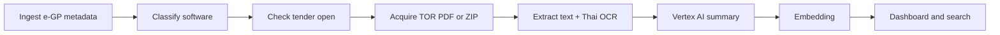

# MoneyTamNgan

Tracks software-related TOR (procurement) projects from Thailand's e-GP portal: it ingests project metadata, downloads and reads the TOR documents (text and Thai OCR), summarises them with Vertex AI, and shows them in a Next.js dashboard with search, matching and analytics. A Bid Preparation Assistant helps sellers prepare bid documents; it never submits a bid.


## Software Development Security project (01219325)

### 1. Application name and team members

**MoneyTamNgan** helps software contractors discover Thai procurement opportunities and prepare bid documents. Team roster confirmed on 19 November 2026:

| Team member |
| --- |
| Phruek Chantarasittiphon |
| Watcharapat Pathanutpong |
| Peerawat Theerasakul |
| Napat Sirichan |

The detailed [18-criterion security audit and project report](docs/security-assignment-audit-2026-11-19.md) records the implementation, tests, limitations and submission checklist. It assesses **13 criteria as covered and five as partial**; this is not a claim of complete OWASP ASVS compliance.

### 2. Functional features

- Discover government/e-GP projects, classify software work and assess bidding availability.
- Acquire PDF/ZIP sources, extract embedded text or Thai OCR, and retain document/extraction provenance.
- Use Vertex AI to summarize TORs, identify restrictive conditions, and extract fiscal-year and announcement-schedule evidence.
- Search/filter projects, compare skill matches and view procurement analytics.
- Manage company profiles, bid checklists and saved drafts; export reviewed drafts as DOCX. The app does not submit bids to e-GP.
- Send opted-in threshold notifications and daily digests; provide protected admin review and pipeline controls.

Government availability, anti-bot pages, OCR quality and AI accuracy can limit results. See [pipeline details](docs/pipeline.md). Installation commands remain under [Quick start](#quick-start) and [Run with Docker](#run-with-docker).

### 3. Security features mapped to OWASP ASVS

Mapping uses [OWASP ASVS 5.0.0](https://asvs.owasp.org/). These are selected implemented controls, not an exhaustive Level 1 checklist. [The audit](docs/security-assignment-audit-2026-11-19.md#3-security-features-mapped-to-owasp-asvs-security-requirements) also maps gaps and [OWASP Top 10:2025](https://top10.owasp.org/2025/).

| Security feature | Selected ASVS 5.0.0 reference | Implementation/evidence |
| --- | --- | --- |
| Password signup/login and salted scrypt hashes | `6.2.1`, `11.4.2` | [Password controls](lib/password-auth.js), [auth tests](tests/integration/password-auth.integration.test.js) |
| Google OAuth authorization-code sign-in | Authentication/federation chapters V6/V10; not a claim of complete chapter coverage | [Google callback](app/api/auth/google/callback/route.js), [OAuth tests](tests/integration/google-oauth-security.integration.test.js) |
| Roles/scopes and owner-bound data access | `8.2.1`, `8.2.2`, `8.3.1` | [Authorization](lib/request-authorization.js), [RBAC spec](docs/security/RBAC_SPEC.md), [ownership tests](tests/security/bid-prep-access.test.js) |
| Signed tokens, HS256 allowlist and expiration | `9.1.1`, `9.1.2`, `7.3.2` | [JWT helpers](lib/auth.js), [disabled-account checks](lib/account-status.js) |
| Login/API rate limiting | `6.1.1`, `6.3.1`, `2.4.1` | [Authentication design](docs/security/AUTHENTICATION.md), [rate limiter](lib/rate-limit.js) |
| Exact-origin CORS and browser mutation checks | `3.4.2` | [Origin policy](lib/security-policy.js), [scope/CORS tests](tests/security/scopes-cors-headers.test.js) |
| CSP/HSTS/anti-framing/nosniff/referrer headers | `3.4.1`–`3.4.6` (selected/partial) | [Next config](next.config.js), [Proxy](proxy.js), [live header evidence](docs/evidence/security-assignment-2026-11-19/live-http.json) |
| Server input validation and controlled database queries | `2.1.1`, `2.2.1`, `1.2.4` (partial) | [Input dictionary](docs/API_VALIDATION.md), [profile validation](lib/profile-validation.js) |
| Safe errors and security-event logging | `16.5.1`, `16.3.1` (partial) | [Audit helper](lib/auth-audit.js), [BidPrep security](lib/bid-prep/security.js); legacy gaps remain |

**Four distinct advanced features:** scope-based authorization, login-attempt rate limits, backend API rate limits, and JWT expiration checks. Local MFA/OTP, compromised-password screening and an inactivity timeout are not implemented. Rate counters are process-local; copied JWT revocation on logout remains incomplete.

### 4. Threat modeling

The project uses [STRIDE](docs/security/THREAT_MODEL.md) across browser/API, worker/database, external-document, AI and SMTP trust boundaries. Existing threats include forged sessions, admin escalation, cross-user access, malicious files, SSRF, abusive expensive operations and sensitive-data disclosure.

The [audit's prioritized threat checklist](docs/security-assignment-audit-2026-11-19.md#4-threat-modeling-performed-for-this-project) maps mitigations and residual risks. Its priorities are recommendations awaiting team adoption:

| Priority | Examples | Current state |
| --- | --- | --- |
| P0 | Previously exposed credential lifecycle | Confirm revocation; private configuration alone does not revoke a leaked key. |
| P1 | Authorization/ownership, CSRF, session termination, URL checks, error disclosure and logging | Many controls are tested; logout revocation, URL validation and legacy error/log handling remain partial. |
| P2 | AI-output trust, export misuse and operational hardening | Provenance, escaping and non-submission notices exist; human review remains necessary. |

The report marks incomplete mitigations explicitly. It does not assume every historical “Mitigated” row or external spreadsheet status is fully verified.

### 5. Security principles followed

| Principle | How it appears in the implementation |
| --- | --- |
| Least privilege | Role-bounded scopes; separate pipeline/cron credentials; signup cannot assign an admin role. |
| Complete mediation | Both Proxy and route handlers enforce permissions; private data queries use the signed-in owner. |
| Fail-safe defaults | Invalid sessions, unknown protected mutations and unapproved browser origins are rejected. |
| Defense in depth | Authorization, input checks, origin policy, CSP, quotas and CI scanners provide separate layers. |
| Data minimization | Password hashes are hidden; Vertex payloads and security logs use field allowlists. |
| Resource containment | Password-hash concurrency, bounded auth bodies, archive checks and pipeline leases limit damage. |

Source mappings and exceptions are documented in the [security report](docs/security-assignment-audit-2026-11-19.md#5-security-principles-followed-in-the-implementation).

### 6. Security test process

After configuring the local environment, use locked dependencies and run:

```sh
npm ci
npm test
npm run test:vitest
npm run build
npm run audit:dependencies
node scripts/audit-api-documentation.js
```

Fresh verification on **19 November 2026**, baseline `b053761`: **800 tests passed**, production build passed, and raw npm audit reported zero findings. The documentation audit **failed**: two documents omit the checklist PATCH method; OpenAPI lacks 18 live operations and contains six operations without handlers. Green contract tests do not prove full API coverage.

CI runs Semgrep SAST and an OWASP ZAP passive baseline. Latest same-code evidence has **0 High / 50 Warning SAST findings**, and **0 High / 1 Medium / 3 Low / 4 Informational DAST alerts**. See [saved evidence and test process](docs/security-assignment-audit-2026-11-19.md#6-security-test-process), [scanner workflows/reports](docs/security/README.md) and [vulnerability policy](docs/security/VULNERABILITY_MGMT.md). Passive, unauthenticated DAST does not prove authenticated authorization safety; dedicated ownership/scope tests cover those cases separately.

Live local checks verified five HTTP security headers, per-request CSP nonces, exact-origin preflights and 401/403 denial behavior. The team should show the custom header configuration and DevTools Network response headers during the presentation. This audit did not verify production HTTPS, perform a fresh Google login, send another email or run paid Vertex processing.

**Known gaps:** copied-JWT reuse after logout; inconsistent raw error exposure and auth-event logging; legacy input/regex and URL-validation weaknesses; missing password change/common-password screening; and unconfirmed old-key revocation. Full findings, remediation priorities and the final submission checklist are in the [audit report](docs/security-assignment-audit-2026-11-19.md).

## Project documents

- [Security presentation](docs/presentation/moneytamngan-security-en-20slides.pptx): 20 English slides with speaker notes, ASVS/STRIDE mappings, test evidence and remaining gaps.

- [MoneyTamNgan_SRS](https://docs.google.com/document/d/1_o6RmB_G54MWgXHGiePvBzy-vLkhECAzDnhtU15rz0A/edit?usp=sharing): official SRS and use case diagram (TOR aggregation, matching, analytics).
- [SRS adhoc requirement](https://docs.google.com/document/d/1u8PlICl8XWIjGJUca1KImYh5keUNDkgUoAU73ERks8A/edit?usp=sharing): short SRS for the Bid Preparation Assistant (epic #135), waiting for customer confirmation (#143).
- [MoneyTamNgan Testcase doc](https://docs.google.com/spreadsheets/d/1DAK7xXw7uJ3rpTrQNPMUjbzi6WOAh-0dQBn6BTv8dQo/edit?usp=sharing): automated tests mapped to modules and source files.
- [Sprint api planing](https://docs.google.com/spreadsheets/d/1aXUlWRg__PmH6LtbzPxBnOCS7z7v9pk-xxEpwySVCU0/edit?usp=sharing): sprint API plan (ticket, endpoint, expected response, status).
- [MoneyTamNgan Secure Test](https://docs.google.com/spreadsheets/d/1DAK7xXw7uJ3rpTrQNPMUjbzi6WOAh-0dQBn6BTv8dQo/edit?usp=sharing): STRIDE threat catalog and ASVS Level 1 traceability, with the status of each mitigation. Open items are tracked as `[Security]` cards (#105, #106, #189 to #194).
- [TOR Discovery, Extraction, and Display](docs/tor-flow.md): sequence diagram of the pipeline.
- [TOR pull pipeline](docs/pipeline.md): stage-by-stage flowchart with statuses and code locations.

## How a software TOR flows through the system

1. **Discover:** the scheduler or an admin run reads the e-GP feed and stores new projects.
2. **Acquire:** the worker downloads each TOR document (PDF or ZIP).
3. **Extract:** text and OCR, then a Vertex AI summary and embedding.
4. **Display:** the dashboard lists and searches the result; admins can review and override.



Stage details, statuses and failure paths: [docs/pipeline.md](docs/pipeline.md). Actor-by-actor sequence: [docs/tor-flow.md](docs/tor-flow.md).

## Quick start

Requires Node.js 22 and a MongoDB (Atlas or local).

```bash
cp .env.example .env     # set MONGODB_URI, JWT_SECRET and EGP_API_KEY at minimum
npm install
npm run dev              # http://localhost:3000
```

Vertex AI is off by default, so ingestion and PDF downloads work without Google Cloud credentials. To enable it, set `VERTEX_AI_ENABLED=true`, `GOOGLE_CLOUD_PROJECT` and `GOOGLE_APPLICATION_CREDENTIALS` (see [Vertex AI](docs/reference.md#vertex-ai)).

## Run with Docker

```bash
cp .env.example .env
docker compose up --build            # app on :3000, local mongo, worker
curl http://localhost:3000/api/health
```

Against Atlas, with the machine's IP allowed automatically (needs `ATLAS_PUBLIC_KEY`, `ATLAS_PRIVATE_KEY`, `ATLAS_PROJECT_ID` in `.env`):

```bash
docker compose -f docker-compose.yml -f docker-compose.atlas.yml up --build
```

Start, stop and rollback on a demo machine: [docs/local-deployment.md](docs/local-deployment.md).

## Common commands

| Command | What it does |
|---|---|
| `npm test` and `npm run test:vitest` | unit, integration and security tests (no network needed) |
| `npm run build` | production build |
| `npm run db:ensure-indexes` | create or update MongoDB and Atlas Vector Search indexes |
| `npm run db:migrate-users` | backfill usernames (dry run; add `-- --apply` to write) |
| `npm run worker` | process queued TOR jobs |
| `npm run scrape` | download TOR PDFs (`--limit`, `--delay`, `--project-id`) |
| `npm run embed -- --limit=50` | create embeddings for semantic search (needs Vertex) |
| `docker compose run --rm scraper` | one scrape run in Docker |

## Documentation

- [docs/reference.md](docs/reference.md): the full guide (pipeline, ingestion schedule, document storage, Vertex, Thai OCR, scraper commands, CI/CD)
- [docs/api/openapi.yaml](docs/api/openapi.yaml): API contract
- [docs/security/](docs/security/README.md): SAST/DAST, threat model, ASVS checklist, BidPrep security
- [docs/email-password-auth.md](docs/email-password-auth.md): email and username login, migration and rollback
- [docs/vector-search.md](docs/vector-search.md): embeddings and the Atlas Vector Search index
- [docs/admin-pipeline-control.md](docs/admin-pipeline-control.md): admin pipeline controls
- [docs/company-profile.md](docs/company-profile.md): company profile for bids
- [docs/bid-prep-decisions.md](docs/bid-prep-decisions.md): team decisions on the open SRS questions for the Bid Preparation Assistant
- [tests/e2e/](tests/e2e/README.md): browser test for username login (Playwright) and its evidence

## Branches and CI

Work goes into feature branches and is merged into `develop` by pull request. CI runs Build, Test (mocked data), API contract, Semgrep and a health check. A green `develop` is promoted to `main` automatically. Details: [CI/CD and branch flow](docs/reference.md#cicd-and-branch-flow).
