# MoneyTamNgan

Tracks software-related TOR (procurement) projects from Thailand's e-GP portal: it ingests project metadata, downloads and reads the TOR documents (text and Thai OCR), summarises them with Vertex AI, and shows them in a Next.js dashboard with search, matching and analytics. A Bid Preparation Assistant helps sellers prepare bid documents; it never submits a bid.


## Project documents

- [MoneyTamNgan_SRS](https://docs.google.com/document/d/1_o6RmB_G54MWgXHGiePvBzy-vLkhECAzDnhtU15rz0A/edit?usp=sharing): official SRS and use case diagram (TOR aggregation, matching, analytics).
- [SRS adhoc requirement](https://docs.google.com/document/d/1u8PlICl8XWIjGJUca1KImYh5keUNDkgUoAU73ERks8A/edit?usp=sharing): short SRS for the Bid Preparation Assistant (epic #135), waiting for customer confirmation (#143).
- [MoneyTamNgan Testcase doc](https://docs.google.com/spreadsheets/d/1R6gXlBh75GxtKXlraxE6N0eJU5URTa0pgbbUvg4j3GE/edit?usp=sharing): automated tests mapped to modules and source files.
- [Sprint api planing](https://docs.google.com/spreadsheets/d/1aXUlWRg__PmH6LtbzPxBnOCS7z7v9pk-xxEpwySVCU0/edit?usp=sharing): sprint API plan (ticket, endpoint, expected response, status).
- [MoneyTamNgan Secure Test](https://docs.google.com/spreadsheets/d/1zl9NWZmycvNj0Brg7PMB2kdizVcQq-ihKPNbVODycvY/edit?usp=sharing): STRIDE and ASVS security catalog with project status.
- [TOR Discovery, Extraction, and Display](#how-a-software-tor-flows-through-the-system): sequence diagram of the pipeline (below).

## How a software TOR flows through the system

Discovery, document download, text and OCR extraction, Vertex AI summary and embedding, and the dashboard. The source is [docs/diagrams/tor-discovery-extraction-display.mmd](docs/diagrams/tor-discovery-extraction-display.mmd).

```mermaid
sequenceDiagram
    autonumber
    actor Browser
    participant NextPages
    participant NextAPI
    participant Worker
    participant TORPipeline
    participant MongoDB
    participant EGPDataAPI
    participant OfficialEGP
    participant EGPAggregator
    participant VertexAI

    rect rgb(238, 242, 255)
    Note over Browser,VertexAI: Discover the tender
    alt Admin console starts an RSS run
        Browser->>NextAPI: POST /api/admin/pipeline/trigger
        NextAPI->>MongoDB: Take the pipeline lease (one run at a time)
        NextAPI-->>Browser: 202 Accepted with run ID
        Note over NextAPI: The run continues in the background.<br/>The console polls GET /api/admin/pipeline/status.
        NextAPI->>OfficialEGP: Fetch department RSS feeds for B0 drafts and D0 invitations
        OfficialEGP-->>NextAPI: Project IDs, titles, dates and document links
        NextAPI->>NextAPI: Pair draft and invitation entries by project_id
        NextAPI->>MongoDB: Upsert Project with RSS metadata and software classification
        opt Software tender with an invitation link
            NextAPI->>OfficialEGP: Download the official invitation PDF
            OfficialEGP-->>NextAPI: Invitation PDF
            NextAPI->>NextAPI: Extract the bidding schedule and check whether bidding is open
            NextAPI->>MongoDB: Save the invitation as a Document and update the Project schedule
        end
    else Scheduler starts an Open Data API run (06:00, 12:00, 18:00 Asia/Bangkok)
        Note over NextAPI: GitHub Actions cron or scripts/ingestion-scheduler.js<br/>calls POST /api/ingestion/trigger with the admin token
        NextAPI->>EGPDataAPI: Fetch paginated EGP-CONTRACT records from opend.data.go.th
        EGPDataAPI-->>NextAPI: Government project metadata
        NextAPI->>NextAPI: Classify project titles and screen for eligibility
        NextAPI->>MongoDB: Save candidates and enqueue verify_candidate jobs
        NextAPI-->>Browser: 202 Accepted with ingestion counts
        Worker->>MongoDB: Claim a verify_candidate job and read the candidate
        Worker->>OfficialEGP: Verify bid status and deadline from official evidence
        OfficialEGP-->>Worker: Tender status and deadline evidence
        Note over Worker: If official page evidence is inconclusive,<br/>check the matching RSS invitation and its PDF schedule.
        alt Confirmed open software tender
            Worker->>MongoDB: Upsert Project by project_id and enqueue process_project
            Worker->>MongoDB: Claim the process_project job
        else Closed, unverified, or needs classification review
            Worker->>MongoDB: Record the candidate outcome without promoting it
        end
    end
    end

    rect rgb(240, 253, 244)
    Note over Browser,VertexAI: Acquire and store the TOR document
    opt Eligible project needs a TOR document
        alt Admin RSS path
            NextAPI->>TORPipeline: Acquire the TOR using the RSS draft link when available
        else Scheduled worker path
            Worker->>TORPipeline: Run processProject(project_id)
        end
        alt Known official document URL works
            TORPipeline->>OfficialEGP: Download the linked PDF or draft ZIP
            OfficialEGP-->>TORPipeline: PDF or ZIP bytes
        else Direct link is missing or fails and browser fallback is enabled
            TORPipeline->>EGPAggregator: Resolve project_id to an official detail URL
            EGPAggregator-->>TORPipeline: Encrypted official e-GP detail URL
            TORPipeline->>OfficialEGP: Open the detail page with Puppeteer and download its ZIP or PDF
            OfficialEGP-->>TORPipeline: PDF or ZIP bytes
        end
        opt A valid TOR file was downloaded
            TORPipeline->>TORPipeline: Extract PDFs if ZIP, select the primary TOR, compute SHA-256
            TORPipeline->>MongoDB: Save Document records with source URL, hash and storage metadata
            TORPipeline->>MongoDB: Set Project.primary_document_id
            Note over TORPipeline,MongoDB: Source files are temporary by default.<br/>With retention enabled, the configured backend keeps the primary PDF.
        end
    end
    end

    rect rgb(255, 247, 237)
    Note over Browser,VertexAI: Extract text, structured fields and embeddings
    opt A primary TOR PDF is available for extraction
        Note over NextAPI,TORPipeline: The admin runner calls processProject directly after acquisition.<br/>The scheduled path calls it from the Worker.
        loop For each page of the primary TOR PDF
            TORPipeline->>TORPipeline: Read embedded text with Poppler
            opt Page text is missing or unreadable
                TORPipeline->>TORPipeline: Render the page and run Tesseract OCR (Thai and English)
            end
        end
        TORPipeline->>MongoDB: Save ExtractionRun and DocumentPage records
        TORPipeline->>MongoDB: Set Project.latest_extraction_run_id
        TORPipeline->>TORPipeline: Remove temporary files after saving text when retention is off
        alt Readable text and Vertex AI enabled
            TORPipeline->>VertexAI: Send page-numbered text chunks to Gemini for structured extraction
            VertexAI-->>TORPipeline: Summary, qualifications, scope, tech stack and page-backed findings
            TORPipeline->>TORPipeline: Validate and merge the results
            TORPipeline->>MongoDB: Save DocumentSummary and set Project.latest_summary_id
            TORPipeline->>MongoDB: Set completed or review_required
            opt Worker finished a completed project
                Worker->>VertexAI: Embed the summary with text-embedding-005 (768 dimensions)
                VertexAI-->>Worker: Embedding vector
                Worker->>MongoDB: Save Project.vectorEmbedding and embedding status
                Note over Worker,MongoDB: An idle sweep retries missing or failed embeddings.<br/>The Atlas Vector Search index project_vector_index serves them.
            end
        else Readable text and Vertex AI disabled
            TORPipeline->>MongoDB: Set ai_pending and keep the extracted page text
        else No readable pages
            TORPipeline->>MongoDB: Set review_required
        end
    end
    opt Project is review_required or low confidence
        Browser->>NextAPI: Admin opens the review queue and overrides classification or status
        NextAPI->>MongoDB: Save the override with an audit record
    end
    end

    rect rgb(253, 242, 248)
    Note over Browser,VertexAI: Load the dashboard and TOR detail
    Browser->>NextPages: Open /dashboard
    NextPages-->>Browser: Dashboard page
    Browser->>NextAPI: GET /api/tors with search, filters and pagination
    NextAPI->>MongoDB: Query Projects (text index and facet filters) and load linked records
    MongoDB-->>NextAPI: Project metadata and available extraction results
    NextAPI->>NextAPI: Build TOR cards and compute match scores when a user profile exists
    NextAPI-->>Browser: Paginated TOR cards
    opt Load agency filter options
        Browser->>NextAPI: GET /api/tors/facets
        NextAPI->>MongoDB: Aggregate agencies from Projects
        NextAPI-->>Browser: Agency options and counts
    end
    Browser->>NextPages: Open /tors/{id} from a card
    NextPages->>NextAPI: Server-side GET /api/tors/{id}
    NextAPI->>MongoDB: Find Project by project_id and load its linked records
    MongoDB-->>NextAPI: Project, document metadata, extraction status and summary
    NextAPI-->>NextPages: TOR detail JSON
    NextPages-->>Browser: Render TOR details, qualifications, findings, schedule and source links
    opt User opens the original TOR
        Browser->>OfficialEGP: Follow the stored Document.source_url
        OfficialEGP-->>Browser: Original PDF or ZIP
    end
    end
```



## Quick start

Requires Node.js 22 and a MongoDB (Atlas or local).

```bash
cp .env.example .env     # set MONGODB_URI, JWT_SECRET and EGP_API_KEY at minimum
npm install
npm run dev              # http://localhost:3000
```

Vertex AI is off by default, so ingestion and PDF downloads work without Google Cloud credentials. To enable it, set `VERTEX_AI_ENABLED=true`, `GOOGLE_CLOUD_PROJECT` and `GOOGLE_APPLICATION_CREDENTIALS` (see [Vertex AI](docs/reference.md#vertex-ai)).

## Run with Docker

```bash
cp .env.example .env
docker compose up --build            # app on :3000, local mongo, worker
curl http://localhost:3000/api/health
```

Against Atlas, with the machine's IP allowed automatically (needs `ATLAS_PUBLIC_KEY`, `ATLAS_PRIVATE_KEY`, `ATLAS_PROJECT_ID` in `.env`):

```bash
docker compose -f docker-compose.yml -f docker-compose.atlas.yml up --build
```

Start, stop and rollback on a demo machine: [docs/local-deployment.md](docs/local-deployment.md).

## Common commands

| Command | What it does |
|---|---|
| `npm test` and `npm run test:vitest` | unit, integration and security tests (no network needed) |
| `npm run build` | production build |
| `npm run db:ensure-indexes` | create or update MongoDB and Atlas Vector Search indexes |
| `npm run db:migrate-users` | backfill usernames (dry run; add `-- --apply` to write) |
| `npm run worker` | process queued TOR jobs |
| `npm run scrape` | download TOR PDFs (`--limit`, `--delay`, `--project-id`) |
| `npm run embed -- --limit=50` | create embeddings for semantic search (needs Vertex) |
| `docker compose run --rm scraper` | one scrape run in Docker |

## Documentation

- [docs/reference.md](docs/reference.md): the full guide (pipeline, ingestion schedule, document storage, Vertex, Thai OCR, scraper commands, CI/CD)
- [docs/api/openapi.yaml](docs/api/openapi.yaml): API contract
- [docs/security/](docs/security/README.md): SAST/DAST, threat model, ASVS checklist, BidPrep security
- [docs/email-password-auth.md](docs/email-password-auth.md): email and username login, migration and rollback
- [docs/vector-search.md](docs/vector-search.md): embeddings and the Atlas Vector Search index
- [docs/admin-pipeline-control.md](docs/admin-pipeline-control.md): admin pipeline controls
- [docs/company-profile.md](docs/company-profile.md): company profile for bids

## Branches and CI

Work goes into feature branches and is merged into `develop` by pull request. CI runs Build, Test (mocked data), API contract, Semgrep and a health check. A green `develop` is promoted to `main` automatically. Details: [CI/CD and branch flow](docs/reference.md#cicd-and-branch-flow).
