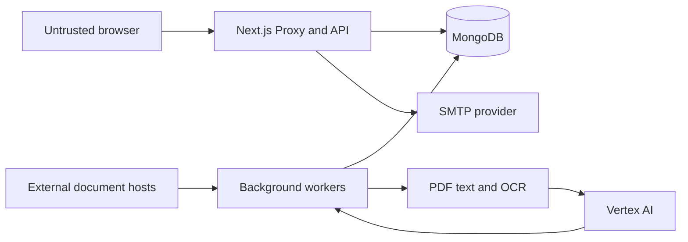

# MoneyTamNgan: Software Development Security Report

Course: 01219325 Software Development Security  
Evidence baseline: 19 November 2026, Asia/Bangkok  
Document revised: 20 November 2026  
Audited commit: `b053761a9222f4300f4519ead308ccd67514b191`

## Scope and results

MoneyTamNgan helps users find Thai software procurement opportunities, read TOR documents and prepare bid drafts. This report explains its security controls, how they were tested and what still needs work.

The assessment covers the code and evidence reviewed on 19 November 2026. It rates 13 course criteria as covered and five as partial: threat prioritization, validation, credential lifecycle, error handling and logging. “Covered” means that an implementation or required evidence exists; it does not mean full ASVS compliance or a guaranteed grade.

The four advanced controls are scoped authorization, login-attempt limits, backend API limits and JWT expiration checking. MFA is not implemented. The 24-hour token lifetime is an absolute expiry, not an inactivity timeout.

The audit recorded 340 passing Node tests and 460 passing Vitest tests, along with a successful production build and local HTTP checks. These 800 tests include functional and security tests. The separate API documentation audit failed. This revision corrects the report; it does not claim that these tests were rerun on 20 November.

## 1. Application Name and All Team Members

MoneyTamNgan is a web application for discovering Thai software procurement opportunities, analysing TOR documents and preparing bid drafts.

The frontend uses Next.js App Router and React. Node.js route handlers and workers handle the backend, with MongoDB and Mongoose for storage. The document pipeline uses HTTP requests and Puppeteer for acquisition, Poppler for embedded text and page rendering, Tesseract for OCR, and Google Vertex AI for analysis.

### Team members

| ID | Team Member Name |
| :---- | :---- |
| 6710545733 | Phruek Chantarasittiphon |
| 6710545881 | Watcharapat Pathanutpong |
| 6610545880 | Peerawat Theerasakul |
| 6710545571 | Napat Sirichan |

## 2. Functional Features

The main features are:

- Procurement discovery from government APIs and e-GP feeds, software classification, and bidding-status checks.
- PDF and ZIP acquisition, embedded-text extraction, Thai OCR, and document hash/provenance tracking.
- Vertex-assisted summaries and restrictive-condition analysis, with fiscal-year and announcement-schedule extraction.
- Search, budget/agency filters, analytics and matching against company skills.
- Company profiles, matching alerts and scheduled email digests.
- Private bid drafts, compliance checklists and DOCX export. Users review the content and submit bids themselves; the application does not submit to e-GP.
- Protected admin tools for pipeline control, classification and review.

Government portal availability and anti-bot checks can interrupt acquisition. Low-quality scans can reduce OCR accuracy, and AI output still needs user review. The application does not guarantee successful extraction from every upstream document.

## 3. Security Features Mapped to OWASP ASVS Security Requirements

The table uses selected requirements from the [ASVS 5.0.0 release catalogue](https://github.com/OWASP/ASVS/blob/v5.0.0/5.0/docs_en/OWASP_Application_Security_Verification_Standard_5.0.0_en.csv). It describes project controls and their limits, rather than claiming full Level 1 or Level 2 compliance. Short labels are paraphrases.

### 3.1 Selected ASVS requirements

| Versioned Requirement | Level | Short Label | Primary Codebase Location | Implementation Assessment & Qualification |
| :---- | :---- | :---- | :---- | :---- |
| `v5.0.0-2.1.1` | 1 | Validation documentation | `docs/API_VALIDATION.md`, `scripts/audit-api-documentation.js` | **Partial:** Data dictionary documents parameter rules, but the checklist `PATCH` endpoint entry is currently missing. |
| `v5.0.0-2.2.1` | 1 | Positive input validation | `lib/password-auth.js`, `app/api/profile/route.js`, `lib/bid-prep/drafts.js` | **Partial:** Strong schema/allowlist validation on auth, profile, and BidPrep routes; legacy validation gaps remain on older routes. |
| `v5.0.0-1.2.4` | 1 | Database injection defenses | `models/*`, `app/api/tors/route.js` | **Partial:** Mongoose ODM type casting and regex escaping are used on primary search routes, but legacy `/api/projects?search=` raw regex and endpoint gaps prevent a blanket claim. |
| `v5.0.0-6.1.1` | 1 | Document anti-automation | `docs/security/AUTHENTICATION.md` | **Implemented:** Authentication architecture, fixed-window rate limits, and threshold values are documented. |
| `v5.0.0-6.2.1` | 1 | Minimum password length | `lib/password-auth.js` | **Implemented:** Enforces 15–128 Unicode code points with a UTF-8 byte cap. |
| `v5.0.0-6.3.1` | 1 | Resist automated login | `lib/rate-limit.js`, `lib/oauth-security.js`, `lib/password-auth.js` | **Implemented (with limit):** Enforces IP-based (30/15m) and identifier/account-based (10/15m) rate limits; single-process memory limitations apply. |
| `v5.0.0-10.2.1` | 2 | OAuth client CSRF protection | `lib/oauth-security.js`, `app/api/auth/google/callback/route.js` | **Implemented:** A random state value is stored in an HttpOnly cookie and checked on callback. Google is the authorization server; this row assesses the application's client behavior. |
| `v5.0.0-11.4.2` | 2 | Password KDF storage | `lib/password-auth.js`, `models/User.js` | **Implemented:** Uses Node.js `crypto.scrypt` (`N=131072, r=8, p=1`), unique 16-byte per-password salt, constant-time `crypto.timingSafeEqual`, and `select: false` on hashes. |
| `v5.0.0-3.4.2` | 1 | Constrain CORS origins | `lib/security-policy.js`, `proxy.js`, `next.config.js` | **Implemented:** Exact allowlist (`APP_ORIGIN`, `CORS_ALLOWED_ORIGINS`); wildcard `*`, `null`, and foreign origins are rejected. |
| `v5.0.0-3.4.1` | 1 | HSTS policy | `lib/security-policy.js`, `next.config.js` | **Implemented in code:** `Strict-Transport-Security: max-age=31536000; includeSubDomains` verified in HTTP responses; live TLS enforcement depends on production reverse proxy. |
| `v5.0.0-3.4.3` | 2 | CSP protection | `lib/security-policy.js`, `proxy.js` | **Partial:** Per-request script nonces, `default-src 'self'`, `object-src 'none'`, and `frame-ancestors 'none'` are enforced, but `base-uri 'self'` differs from the strict catalogue minimum `base-uri 'none'`. |
| `v5.0.0-8.2.1`, `8.2.2`, `8.3.1` | 1 | Function, object & server authorization | `lib/admin-auth.js`, `lib/request-authorization.js`, `app/api/profile/route.js`, `lib/bid-prep/security.js` | **Implemented for tested resources:** Server-side role/scope gates (`user`, `admin`, machine scopes) plus `session.sub` owner-qualified queries (HTTP 404 on cross-user draft access). |
| `v5.0.0-9.1.1`, `9.1.2` | 1 | Token signature & algorithm checks | `lib/auth.js` | **Implemented:** `jose.jwtVerify()` validates HMAC signatures strictly pinned to `HS256`; `none` and `HS384` algorithms are rejected. |
| `v5.0.0-7.3.2` | 2 | Absolute session lifetime | `lib/auth.js` | **Implemented:** JWTs expire after 24 hours (86,400 seconds). Whether this duration is appropriate still needs a risk decision. |
| `v5.0.0-7.4.1` | 1 | Revoke terminated sessions | `app/api/auth/logout/route.js`, `lib/auth.js` | **Not Met for Copied JWTs:** Logout clears the `mtn_session` cookie (`maxAge: 0`), but a copied bearer JWT remains valid until expiration because server-side token revocation is not yet implemented. |
| `v5.0.0-7.4.2` | 1 | Disable-account session termination | `lib/account-status.js`, `lib/auth.js` | **Implemented:** `verifyActiveSession()` checks token validity, then account existence and the `disabled` flag for real account IDs. Protected requests reject invalid or disabled-account sessions; public routes may continue as guests. |
| `v5.0.0-16.3.1` | 2 | Authentication event logging | `lib/auth-audit.js`, `models/PipelineTriggerAudit.js` | **Partial:** Structured audit logging exists for OAuth denials, pipelines, and BidPrep actions, but password registration, login, and logout coverage is incomplete. |
| `v5.0.0-16.5.1` | 2 | Safe unexpected errors | `lib/route-security.js`, `lib/password-auth.js` | **Partial:** Generic error envelopes are used in auth and BidPrep handlers, while several legacy/health/OAuth error paths still expose `error.message` or provider details. |

### 3.2 Other controls and limits

The application also uses React output escaping, explicit process arguments, file-signature checks and path checks during ZIP extraction. These support the controls above, but do not establish that every route or parser is safe.

Google sign-in uses a server-side authorization-code exchange and a verified Google profile response. The current callback reads Google's UserInfo endpoint rather than demonstrating a complete ID Token validation flow. The report therefore does not claim all OIDC client requirements. ASVS section 10.4 concerns authorization-server behavior and is not credited to MoneyTamNgan merely because it uses Google.

The container runs as a non-root user. Local environment files and Git metadata are excluded from its build context. Production HTTPS with an appropriate TLS configuration remains a deployment requirement: the local HTTP audit did not verify a public reverse proxy or TLS enforcement.

Other gaps include password change/reset, common or compromised-password screening, inactivity timeout, and the session cookie's missing secure-name prefix. CSP has per-request script nonces, but still permits inline styles and uses `base-uri 'self'`. These limits prevent a full ASVS compliance claim.

The vulnerability policy requires Critical findings to be fixed or mitigated within **7 days**, with a compensating control within **48 hours** when no fix exists. High findings have a **14-day** deadline, Medium findings **30 days**, and Low findings at most **90 days**. An exception needs a written rationale and expiry. The deadlines come from the repository's [vulnerability policy](https://github.com/MoneyTamNgan/MoneyTamNgan/blob/b053761a9222f4300f4519ead308ccd67514b191/docs/security/VULNERABILITY_MGMT.md).

## 4. Threat Modeling Performed for This Project

### 4.1 System Trust Boundaries & Untrusted Inputs

The repository's STRIDE model records TH-1 through TH-20. The shared sheet uses its own numbering; its ZIP traversal threat is referenced as **sheet TH-03**, which is distinct from repository TH-3.

The main trust boundaries are the browser to Next.js, the API/worker to MongoDB, the acquisition worker to government document hosts, document text to Vertex AI, and the notification service to SMTP. Browser input, document URLs, redirects, archive paths and AI output require validation at the boundary where they are used.

### 4.2 Threats, mitigations and verification

The following table preserves repository threat meanings. Status describes the audited code, not every possible attack against the feature.

| Threat ID and scenario | STRIDE category | Mitigation and evidence | Status or limitation |
| --- | --- | --- | --- |
| TH-1: Forged or legacy session; TH-8: Pipeline token used as admin | Spoofing / elevation of privilege | Signed, role-bounded scopes and machine-principal boundaries; `scopes-cors-headers.test.js`. | Tested for the implemented permission boundaries. |
| TH-2: OAuth login abuse | Spoofing | Separate start/callback limits, state checks and denial logs; `lib/oauth-security.js`. | Implemented; live provider sign-in was outside this audit. |
| TH-3: Profile mass assignment | Tampering | Owner-bound updates and field allowlists; `scoped-profile-route.integration.test.js`. | Tested. |
| TH-4: Authentication events not attributable | Repudiation | Allowlisted audit metadata; `lib/auth-audit.js`. | Partial: password signup/login/logout coverage and retention are incomplete. |
| TH-5: Password-hash disclosure; TH-6: Login errors distinguish accounts | Information disclosure | Hidden hashes, public response allowlists and uniform password-login failure; `models/User.js`, `lib/password-auth.js`. | Implemented; this does not establish generic error handling on every route. |
| TH-7: Guest/login floods; TH-13: Excessive Vertex cost or oversized drafts | Denial of service | Fixed-window limits, bounded KDF concurrency, draft quotas and body caps. | Process-local limits; replicas do not share counters. |
| TH-9: Cross-site mutations; TH-16: CSRF on drafts/deletion | Tampering | Exact origins and independent route checks; `lib/security-policy.js`, `lib/route-security.js`. | Tested. Browser CORS does not replace authentication for non-browser clients. |
| TH-10: Remote document URL targets a private host | Information disclosure | Scheme, literal-address and redirect checks; `lib/url-safety.js`. | Partial: the helper accepted IPv6 loopback. No request was made; this was not a demonstrated end-to-end SSRF exploit. DNS/private-address handling needs further work. |
| TH-11: Prompt injection in TOR text | Tampering | Fixed instructions and delimited document data; `lib/bid-prep/vertex-payload.js`. | Payload controls tested; model behavior is not guaranteed. |
| TH-12: Cross-user access to drafts, checklists or company data | Elevation of privilege | Owner-qualified queries and foreign-draft 404 responses; `bid-prep-access.test.js`. | Tested for these resources. |
| TH-14: Company-data leakage | Information disclosure | Vertex field allowlists, audit allowlists and delete-and-verify behavior; `bid-prep-privacy.test.js`. | Controls tested; retention is subject to the documented team decision and customer confirmation. |
| TH-15: AI text treated as a submitted bid; TH-18: BidPrep submits to e-GP | Repudiation / elevation of privilege | Draft/non-submission notices and no bid-submission client. | Tested; the seller still checks and submits the bid. |
| TH-17: Formula or markup in exports | Tampering | Plain-content DOCX and escaping; `bid-prep-privacy.test.js`. | Tested within the export implementation. |
| TH-19: Parallel runs or restart leaves a stuck pipeline | Denial of service / tampering | Atomic lease, heartbeat, expiry recovery and owner fencing; `admin-pipeline-recovery.test.js`. | Tested. |
| TH-20: Unauthorized or unattributed pipeline trigger | Repudiation / elevation of privilege | Independent admin guards and trigger audit; `admin-pipeline.integration.test.js`. | Tested. |
| Sheet TH-03: ZIP path traversal | Tampering | Extraction-root confinement and symlink rejection; `zip-slip.test.js`. | Tested within the extractor; not a guarantee against every parser vulnerability. |

### 4.3 Open findings and proposed priorities

New audit findings have separate IDs below instead of changing the meaning of existing STRIDE IDs. Priorities are recommendations pending team agreement. P0 means confirm before public release; P1 means address before public production deployment; P2 means scheduled hardening.

| Finding | Priority | Next action | Owner/status at the audit baseline |
| --- | --- | --- | --- |
| AUD-01: Revocation of a previously exposed credential is unconfirmed | P0 | Confirm revocation with the credential owner and retain a sanitized record. A clean history scan is not proof of revocation. | Account-owner confirmation pending. |
| AUD-02: Copied JWT remains usable after logout | P1 | Add server-side revocation or session-version invalidation and a replay test. | Open; implementation owner to be assigned. |
| AUD-03: Legacy errors expose internal/provider details | P1 | Return safe client errors and record sanitized technical details server-side. | Open; implementation owner to be assigned. |
| AUD-04: Validation, private-host URL checks and auth logging are inconsistent | P1 | Close the documented endpoint gaps and add focused tests, including IPv6 and DNS cases. | Open; implementation owner to be assigned. |
| AUD-05: Rate limits do not span replicas; documentation and deployment evidence need upkeep | P2 | Plan shared counters, fix API documentation, and capture deployment/header evidence. | Follow-up; team agreement pending. |

## 5. Security Principles Followed in the Implementation

| Security Design Principle | Concrete Implementation in MoneyTamNgan | Key Files & Artifacts | Residual Limitation / Qualification |
| :---- | :---- | :---- | :---- |
| **1. Least Privilege** | Separates `user`, `admin`, and machine/worker token scopes (`profile:read`, `profile:write`, pipeline scopes); forces `role: 'user'` on self-registration; scopes queries to `session.sub`. | `lib/auth.js`, `lib/request-authorization.js`, `lib/admin-auth.js` | `JWT_SECRET` and `MONGODB_URI` remain high-trust deployment assets requiring strict IAM protection. |
| **2. Complete Mediation** | Enforces authentication and origin checks at the Next.js proxy layer plus independent authorization and ownership guards inside protected handlers covered by the audit. | `proxy.js`, `lib/route-security.js`, `app/api/admin/*`, `app/api/bid-prep/*` | Any newly created API endpoints must explicitly adopt the shared route guards and ownership tests. |
| **3. Fail-Safe Defaults** | Rejects requests missing valid sessions (`401`), unauthorized roles/scopes (`403`), disallowed CORS origins, invalid JWT algorithms (`none`/`HS384`), and malformed file magic bytes by default. | `lib/security-policy.js`, `lib/auth.js`, `lib/scraper.js` | Legacy error envelopes and input schemas are inconsistent across older endpoints. |
| **4. Defense in Depth** | Layers multiple independent controls: CSP nonces + security headers, exact CORS allowlists, rate limiters, Mongoose schema casting, Zip Slip path confinement, and CI Semgrep/ZAP gates. | `next.config.js`, `lib/archive-extractor.js`, `.github/workflows/*` | Automated scanners do not prove complete safety; documented partial controls remain explicit. |
| **5. Minimize Exposed Data** | Hides `passwordHash` via Mongoose `select: false`; excludes `.env*` and `.git` from builds; sends only allowlisted profile/TOR fields to Vertex AI and audit logs. | `models/User.js`, `.dockerignore`, `lib/auth-audit.js` | Historical Resend key revocation confirmation and formal log retention policy remain open. |
| **6. Limit Resources & Isolate Work** | Bounds `scrypt` hashing concurrency, caps BidPrep request bodies at 128 KiB and drafts at 5/hour, enforces download byte limits, isolates test databases, and uses atomic worker leases. | `lib/password-auth.js`, `lib/bid-prep/security.js`, `lib/ingestion-runner.js` | Rate-limit counters are in-memory per process; legacy search/notification inputs require bounds. |

## 6. Security Test Process

### 6.1 How the audit was carried out

1. **Baseline Pinning & Isolation:** Pinned the audited commit tree (`b053761a9222f4300f4519ead308ccd67514b191`) in an isolated worktree using locked dependency versions (`package-lock.json`).  
2. **Specification-to-Code Traceability:** Reviewed security specs (`ASVS_CHECKLIST.md`, `THREAT_MODEL.md`, `RBAC_SPEC.md`, `API_VALIDATION.md`) and verified actual enforcement in source code and integration tests rather than accepting status labels at face value.  
3. **Automated Unit, Integration, Build & Audit Suites:** Executed the full Node test suite, Vitest suite, production Next.js build, `npm audit` dependency check, Redocly OpenAPI linter, and API documentation consistency audit.  
4. **CI SAST & DAST Artifact Verification:** Retrieved the latest successful GitHub Actions Semgrep SAST (`run 44472921630`) and OWASP ZAP DAST (`run 44472812671`) artifacts and verified tree hash equivalence (`c5e04d7…` shared between DAST commit `38849ab` and audited commit `b053761`).  
5. **Local Loopback Runtime Smoke & JWT Verification:** Launched a local production build on port `3119` using dummy credentials (zero production database writes or external API calls) to verify live HTTP security headers, per-request CSP script nonces, CORS origin allow/deny behavior, `401`/`403` denials, JWT signature/algorithm/expiration checks, and post-logout token behavior.  
6. **Bounded Historical Secret Scanning:** Scanned 1,532 locally fetched Git text blobs using bounded regular expression patterns for leaked credentials, outputting only non-sensitive metadata.  
7. **Gap & Residual Risk Recording:** Documented all failed checks, scanner warnings, and residual risks transparently for remediation prior to production deployment.

### 6.2 Results recorded on 19 November 2026

| Verification Check / Tool | Execution Command / Source | Result & Findings |
| :---- | :---- | :---- |
| **Node Native Test Suite** | `npm test` | **Passed:** 340 passed, 0 failed |
| **Vitest Unit & Security Suite** | `npm run test:vitest` | **Passed:** 460 passed, 0 failed (50 test files) |
| **Production Build** | `npm run build` | **Passed:** Clean production build with dummy config |
| **Dependency Vulnerability Audit** | `npm run audit:dependencies` & `npm audit` | **Passed on 19 November:** 0 findings in the raw npm registry audit (prior `picomatch` advisory withdrawn 18 Nov 2026) |
| **OpenAPI Specification Lint** | Cached Redocly CLI | **Passed:** 0 errors, 9 warnings, 4 explicitly ignored |
| **API Documentation Consistency Audit** | `node scripts/audit-api-documentation.js` | **Failed (Action Required):** Checklist `PATCH` method omitted in 2 docs; 18 live routes missing from OpenAPI spec; 6 spec-only operations |
| **Local HTTP Smoke & CORS Checks** | Loopback server on `localhost:3119` | **Passed:** 5 security headers, fresh per-request CSP nonce, configured origin accepted, `*`/`null`/foreign origins rejected, `401`/`403` denials verified |
| **JWT Cryptographic & Session Checks** | Offline & live token verification | **Mixed:** Expired JWT and `HS384` rejected; 24h (`86,400s`) lifetime confirmed. Copied-token validity after logout remains an open finding |
| **Git History Secret Scan** | Bounded regex scan over 1,532 text blobs | **No candidates found:** bounded scan only; not proof that no secrets exist |
| **SAST Static Analysis (Semgrep)** | GitHub Actions (`p/owasp-top-ten`) | **0 High/Error**, 50 Warnings (20 mutable action tags, 25 HTTP links in report artifacts, 4 workflow env-secret notices, 1 raw-HTML format warning), 2 warning-level parse errors |
| **DAST Dynamic Analysis (OWASP ZAP)** | GitHub Actions baseline container scan | **0 High**, 1 Medium (`style-src 'unsafe-inline'`), 3 Low (`COEP`/`COOP`/`CORP`), 4 Informational (unauthenticated passive spider scope) |

## Appendix A: Course Evaluation Criteria Matrix (Items 1–18)

| # | Course Evaluation Criterion | Audit Status | Supporting Evidence & Qualification |
| :---- | :---- | :---- | :---- |
| 1 | List of ASVS requirements followed | **Covered (Selected Scope)** | Section 3, `docs/security/ASVS_CHECKLIST.md`, `docs/API_VALIDATION.md` (selected ASVS 5.0.0 mapping, not full Level 1 certification). |
| 2 | Threat modeling, priorities & mitigations | **Partial** | Section 4 & `docs/security/THREAT_MODEL.md` (repository TH-1–TH-20 and sheet TH-03); audit added P0/P1/P2 priorities to be synchronized with the team sheet. |
| 3 | Map security design principles | **Covered** | Section 5 links 6 core principles to concrete codebase controls and residual limitations. |
| 4 | Password authentication | **Covered** | `lib/password-auth.js`, `lib/password-auth-handler.js` (email/username login, 15–128 chars, `scrypt` + 16B salt, `timingSafeEqual`, hidden hash). |
| 5 | Social OAuth / OpenID sign-in | **Covered (Code & Tests)** | `app/api/auth/google/callback/route.js`, `lib/oauth-security.js` (Google authorization-code flow, 256-bit state value in an `HttpOnly` cookie). |
| 6 | Role-based authorization | **Covered** | `lib/auth.js`, `lib/request-authorization.js`, `lib/admin-auth.js`, `rbac-route-matrix.test.js` (`user`, `admin`, and machine principals). |
| 7 | Prevent access to another user's data | **Covered (Tested Resources)** | `session.sub` scoping on profiles, BidPrep drafts, and checklists; cross-user draft access returns HTTP 404 (`bid-prep-access.test.js`). |
| 8 | Input validation & injection protection | **Partial** | Typed Mongoose queries, allowlists, 128 KiB BidPrep cap, and `spawn()` arrays exist; legacy `/api/projects?search=` raw regex and notification input bounds remain open. |
| 9 | Environment variables & credentials | **Partial** | `.env.example`, ignored `.env*`, server-only secrets, and 0 matches in 1,532 Git blobs; revocation of earlier exposed Resend key awaits owner confirmation. |
| 10 | CORS without wildcard origins | **Covered** | `lib/security-policy.js`, `next.config.js`, `proxy.js`; live preflight accepts configured origin and rejects `*`, `null`, and foreign origins. |
| 11 | Error handling | **Partial** | Uniform 401 and generic 500 in auth/BidPrep; legacy TOR/project/health and OAuth callback paths expose `error.message` or provider payloads. |
| 12 | Security / event logging | **Partial** | Structured logging for OAuth denials, pipelines, BidPrep, and notifications; password login/registration/logout audit coverage and retention policy incomplete. |
| 13 | HTTP security headers | **Covered** | CSP nonce, HSTS, `X-Frame-Options: DENY`, `nosniff`, `Referrer-Policy`, `Permissions-Policy`, and disabled `X-Powered-By` verified in code and live HTTP. |
| 14 | SAST tool and report | **Covered** | Semgrep CI workflow (`p/owasp-top-ten`): 0 High/Error findings, 50 Warnings. |
| 15 | DAST tool and report | **Covered (Baseline Scope)** | OWASP ZAP CI baseline scan: 0 High, 1 Medium, 3 Low, 4 Info (unauthenticated passive spider). |
| 16 | Map mitigation implementation to threats | **Covered** | Section 4 preserves repository TH-1–TH-20 and sheet TH-03, with separate audit findings and evidence. |
| 17 | Map implementation to ASVS & Top 10 | **Covered (Selected Scope)** | Section 3 (ASVS 5.0.0) and Appendix C (OWASP Top 10:2025). |
| 18 | Four advanced security features | **Covered** | Appendix B details the 4 implemented features (scoped authorization, login rate limiting, backend API rate limiting, JWT expiration & disabled-account checks). |

## Appendix B: Item 18 — Four Selected Advanced Security Features

| Advanced Feature Option | Status | Implementation Details, Files & Known Limitations |
| :---- | :---- | :---- |
| **1. Authorization Process with Scope** | **Implemented (Feature 1/4)** | Signed, role-bounded capability scopes (`profile:read`, `profile:write`, pipeline execution scopes) enforced in `lib/auth.js` and `lib/request-authorization.js` (verified by `tests/security/scopes-cors-headers.test.js`). Read-only tokens cannot mutate state, and pipeline worker tokens cannot access user profiles or admin endpoints. |
| **2. Rate Limit for Login Attempts** | **Implemented (Feature 2/4)** | Enforced in `lib/rate-limit.js`, `lib/password-auth.js`, and `lib/oauth-security.js`: 30 requests / 15 min per client IP, 10 requests / 15 min per targeted identifier/account, and 5 requests / 15 min on Google OAuth start/callback. Returns HTTP 429 with `Retry-After`. *Limit:* Process-local counters require trusted reverse-proxy forwarding headers. |
| **3. Rate Limit for Backend APIs** | **Implemented (Feature 3/4)** | Enforced in `lib/rate-limit.js`, `lib/bid-prep/security.js`, and `proxy.js`: public read endpoints limited to 60 req/min (guest) and 300 req/min (authenticated), plus per-user quotas on Vertex AI BidPrep draft creation (5/hour), exports, and bulk deletions. *Limit:* Not yet applied universally to every legacy endpoint. |
| **4. JWT Expiration Checking & Management** | **Implemented (Feature 4/4)** | Enforced in `lib/auth.js` and `lib/account-status.js` (verified by `tests/security/session-disabled.test.js`): stateless `HS256` JWTs expire after 24 hours (`86,400s`), non-allowlisted algorithms are rejected, and live database checks reject authenticated access for real accounts that are disabled or deleted (`v5.0.0-7.4.2`). *Limit:* Copied tokens are not revoked server-side on logout. |

## Appendix C: OWASP Top 10:2025 Mapping

| OWASP Top 10:2025 Category | Implemented Controls | Remaining Qualification |
| :---- | :---- | :---- |
| **A01: Broken Access Control** | Role/scope gates, `session.sub` owner-qualified queries, strict CORS origin rules. | Maintain authorization tests on new endpoints; remote-fetch private-host checks remain partial. |
| **A02: Security Misconfiguration** | Security headers, CSP nonces, exact CORS allowlists, `HttpOnly` cookies, non-root Docker user. | `style-src 'unsafe-inline'`, missing COEP/COOP/CORP headers, and `mtn_session` cookie prefix. |
| **A03: Software Supply Chain Failures** | Locked `package-lock.json`, dated npm audit evidence, expiring risk manifest, Semgrep SAST. | GitHub Actions use mutable tags; container/action supply-chain coverage is incomplete. Dependency results are dated 19 November. |
| **A04: Cryptographic Failures** | `scrypt` (`N=131072`), 16-byte random salts, `timingSafeEqual`, `HS256` JWT verification, SHA-256 hashes. | Confirm historical Resend key revocation; production HTTPS relies on deployment proxy. |
| **A05: Injection** | Controlled query construction, regex escaping on primary TOR search, allowlists, `spawn()` arrays and export escaping. | Legacy raw regex and notification input bounds remain; private-host URL handling is tracked separately under access control. |
| **A06: Insecure Design** | STRIDE threat model, bounded KDF/AI quotas, atomic MongoDB pipeline leases, non-submission notice. | Team adoption of formal threat priorities and data retention policies. |
| **A07: Authentication Failures** | Password and Google OAuth login, login rate limits, 24h JWT expiry, disabled-account revocation. | Missing password change/reset, breached-password check, MFA, and logout token revocation. |
| **A08: Software or Data Integrity Failures** | Strict JSON parsing, SHA-256 document provenance, PDF/ZIP magic-byte & Zip Slip checks. | LLM summarization output requires user verification; build provenance signing not established. |
| **A09: Security Logging & Alerting Failures** | Structured `logAuthAudit()` and `PipelineTriggerAudit` with allowlisted non-secret fields. | Password login/logout audit coverage and centralized log retention/alerting remain partial. |
| **A10: Mishandling of Exceptional Conditions** | Generic error envelopes in auth/BidPrep, bounded resource quotas, pipeline lease recovery. | Legacy handlers and Google callback expose raw `error.message` or provider payloads. |

## Submission evidence and references

The audit results above refer to the pinned code baseline. They should be updated if the submission code changes. Source paths in the tables are relative to the repository root.

- [Repository and installation instructions](https://github.com/MoneyTamNgan/MoneyTamNgan)
- [Audited code commit](https://github.com/MoneyTamNgan/MoneyTamNgan/commit/b053761a9222f4300f4519ead308ccd67514b191)
- [Detailed audit and limitations](https://github.com/MoneyTamNgan/MoneyTamNgan/blob/docs/security-assignment-audit/docs/security-assignment-audit-2026-11-19.md)
- [Saved verification summary](https://github.com/MoneyTamNgan/MoneyTamNgan/blob/docs/security-assignment-audit/docs/evidence/security-assignment-2026-11-19/verification-summary.json)
- [Semgrep CI run](https://github.com/MoneyTamNgan/MoneyTamNgan/actions/runs/44472921630)
- [ZAP CI run](https://github.com/MoneyTamNgan/MoneyTamNgan/actions/runs/44472812671)
- [Saved SAST JSON](https://github.com/MoneyTamNgan/MoneyTamNgan/blob/docs/security-assignment-audit/docs/evidence/security-assignment-2026-11-19/sast-report.json)
- [Saved ZAP JSON](https://github.com/MoneyTamNgan/MoneyTamNgan/blob/docs/security-assignment-audit/docs/evidence/security-assignment-2026-11-19/zap-dast-report.json)
- [Repository STRIDE model](https://github.com/MoneyTamNgan/MoneyTamNgan/blob/b053761a9222f4300f4519ead308ccd67514b191/docs/security/THREAT_MODEL.md)
- [RBAC specification](https://github.com/MoneyTamNgan/MoneyTamNgan/blob/b053761a9222f4300f4519ead308ccd67514b191/docs/security/RBAC_SPEC.md)
- [API validation dictionary](https://github.com/MoneyTamNgan/MoneyTamNgan/blob/b053761a9222f4300f4519ead308ccd67514b191/docs/API_VALIDATION.md)
- [ASVS 5.0.0 release catalogue](https://github.com/OWASP/ASVS/blob/v5.0.0/5.0/docs_en/OWASP_Application_Security_Verification_Standard_5.0.0_en.csv)
- [OWASP Top 10:2025](https://owasp.org/Top10/2025/)

Before submission, the team should attach a DevTools Network screenshot showing the required response headers, confirm that repository/report/slide links are accessible to the lecturer, agree on owners for the open findings, and confirm exposed-key revocation. These actions are not marked complete by this document revision.
