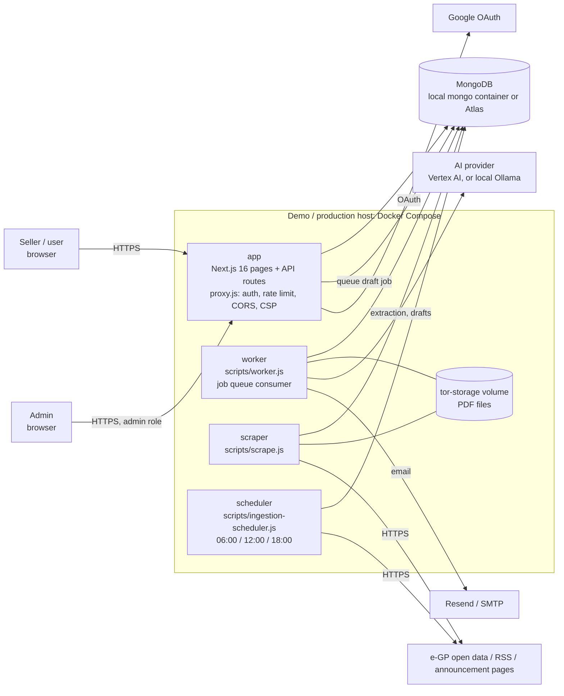
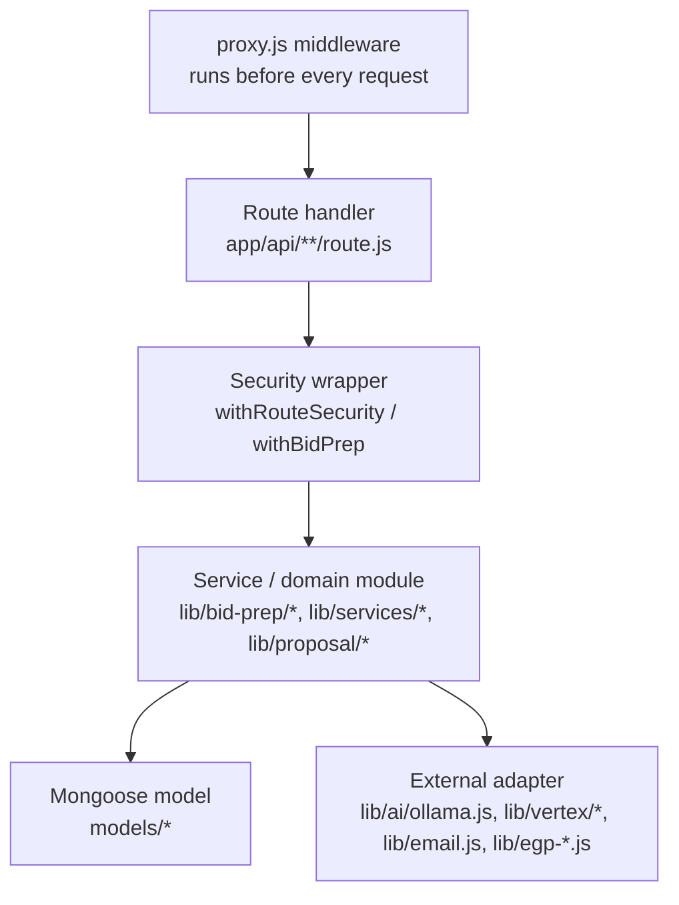
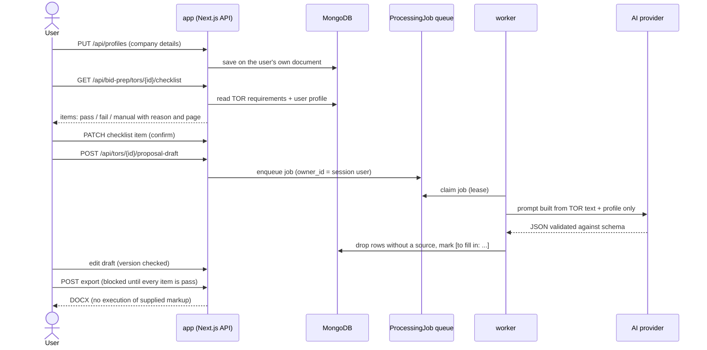

# Architecture, data flow and trust boundaries

## 1. System context

Only `app` is reachable by users (port 3000). `worker`, `scraper` and `scheduler` have no inbound port; they read and write MongoDB and call out to external services.

## 2. Containers and responsibilities

| Container | Code | Responsibility |
|---|---|---|
| `app` | `app/` (pages, `app/api/**/route.js`), `proxy.js`, `components/`, `lib/` | UI and REST API; authentication, authorisation, validation, rate limits, security headers |
| `worker` | `scripts/worker.js`, `lib/processing-pipeline.js`, `lib/job-queue.js` | Claims queued jobs: download, OCR/text extraction, AI extraction, classification, proposal drafts, notification matching |
| `scraper` | `scripts/scrape.js`, `lib/scraper.js`, `lib/document-resolver.js` | Fetches TOR PDFs and archives from e-GP (anti-bot aware) |
| `scheduler` | `scripts/ingestion-scheduler.js`, `lib/ingestion-runner.js` | Starts ingestion runs on the schedule; single-run lock |
| `mongo` / Atlas | `models/*` | Persistence; Atlas Vector Search for semantic search |

## 3. Layers inside `app`

Rule of thumb for auditors: **identity comes only from the signed session** (`requestPrincipal`), never from the request body or URL. Every Bid Prep query filters on the session user id.

## 4. Pipeline (TOR from e-GP to a searchable record)

1. **Discover**: RSS / open data / announcement feed produces `DiscoveryCandidate` and `Project` metadata.
2. **Classify**: keyword rules (`Keyword`) and AI decide software / not software; low confidence goes to the admin review queue (`ClassificationOverride` records every override).
3. **Acquire**: resolve and download the TOR (ZIP/PDF) with size, entry-count and compression-ratio limits; store through the storage backend (`local`, `gridfs`, `gcs`).
4. **Extract text**: embedded text or OCR per page (`DocumentPage`), recorded in an `ExtractionRun` keyed by processor fingerprint and text hash (idempotent).
5. **AI extraction**: Vertex or Ollama returns schema-validated JSON stored in `DocumentSummary` (model and prompt version recorded); low confidence sets `needs_review`.
6. **Enrich**: fiscal budget analysis, anomaly flag, embeddings, revision lineage.
7. **Serve and notify**: list, search, detail, match score; matching users get email (`NotificationDelivery` / `NotificationBatch`, deduplicated).

Stage details and status values: [../pipeline.md](../pipeline.md), [../tor-flow.md](../tor-flow.md).

## 5. BidPrep data flow (the new feature)

The system never submits a bid to e-GP; the seller does that with their own digital signature.

## 6. Trust boundaries

| # | Boundary | Untrusted input | Controls |
|---|---|---|---|
| TB1 | Browser to `app` | Every request field, cookies, headers | `proxy.js`: session check, scope check, CORS allow-list, rate limit, CSP/HSTS; per-route validation ([../API_VALIDATION.md](../API_VALIDATION.md)) |
| TB2 | `app` to MongoDB | Query operators in user data | Typed schemas, controlled queries, ownership filters (input validation: [../API_VALIDATION.md](../API_VALIDATION.md); injection is listed as a partial control in the audit) |
| TB3 | e-GP to `scraper` | HTML, ZIP and PDF from a third party | URL safety (`lib/url-safety.js`, SSRF guard), size and zip-bomb limits, no execution of content |
| TB4 | Documents to AI | TOR text may contain prompt injection | Fixed system prompt, schema-validated output, rows without a source are dropped, injection test recorded |
| TB5 | `worker` to AI provider | Sends TOR text (public) and the owner's profile for drafts | Provider choice is configuration; credentials only in the host environment |
| TB6 | `app` to email | Recipient and content | Frozen payload and idempotency key per batch; deduplicated per user and project |
| TB7 | Host to Atlas | Network path | Atlas IP access list, TLS, least-privilege DB user |

Threat model: [../security/THREAT_MODEL.md](../security/THREAT_MODEL.md). RBAC matrix: [../security/RBAC_SPEC.md](../security/RBAC_SPEC.md).

## 7. Deployment views

| Mode | Command | Database | Use |
|---|---|---|---|
| Local | `docker compose up --build` | bundled `mongo` | development, offline demo |
| Live data | `docker compose -f docker-compose.yml -f docker-compose.atlas.yml up --build` (or the machine-local `docker-compose.real-db.yml`) | MongoDB Atlas | demo with real data |

Start, stop, rollback: [../local-deployment.md](../local-deployment.md).
