# Data model and ER diagram

Traces to: FR-1.1.2, FR-1.1.3, FR-1.3.1, FR-2.2.1, FR-4.1.1, BidPrep FR-4.1, BidPrep FR-4.3. This file is part of the [design document](../design/README.md).

Source of truth: `models/*.js` (Mongoose, MongoDB 7 / Atlas). MongoDB has no foreign keys, so the relations below are enforced by the application and by unique and partial-unique indexes. "FK" means an `ObjectId ref` or a `project_id` string that points at `Project.project_id`.

## Entity-relationship diagram

```mermaid
erDiagram
    USER ||--o{ BID_PREP_DRAFT : "owns (userId)"
    USER ||--o{ NOTIFICATION_DELIVERY : "receives (user_id)"
    USER ||--o{ NOTIFICATION_BATCH : "receives (user_id)"
    NOTIFICATION_BATCH ||--o{ NOTIFICATION_DELIVERY : "groups (delivery_ids)"
    USER ||--o{ PROCESSING_JOB : "owns proposal_draft (owner_id)"

    PROJECT ||--o{ DOCUMENT : "has (project_id, project_ref)"
    PROJECT ||--o| DOCUMENT : "primary_document_id"
    PROJECT ||--o| DOCUMENT : "announcement_document_id"
    PROJECT ||--o| EXTRACTION_RUN : "latest_extraction_run_id"
    PROJECT ||--o| DOCUMENT_SUMMARY : "latest_summary_id"
    PROJECT ||--o| FISCAL_BUDGET_ANALYSIS : "latest_fiscal_analysis_id"
    PROJECT ||--o{ BID_PREP_DRAFT : "target of (projectId)"
    PROJECT ||--o{ NOTIFICATION_DELIVERY : "matched (project_id)"
    PROJECT ||--o{ PROCESSING_JOB : "queued for (project_id)"
    PROJECT ||--o{ CLASSIFICATION_OVERRIDE : "audited (project_id)"
    PROJECT ||--o{ ACQUISITION_ATTEMPT : "acquired (project_id)"
    PROJECT ||--o| DISCOVERY_CANDIDATE : "before promotion (project_id)"

    DOCUMENT ||--o{ DOCUMENT_PAGE : "pages (document_id)"
    DOCUMENT ||--o{ EXTRACTION_RUN : "extracted by (document_id)"
    DOCUMENT ||--o{ DOCUMENT_SUMMARY : "summarised (document_id)"
    DOCUMENT ||--o| DOCUMENT : "previous_document_id (version chain)"
    EXTRACTION_RUN ||--o{ DOCUMENT_PAGE : "produces (extraction_run_id)"
    EXTRACTION_RUN ||--o{ DOCUMENT_SUMMARY : "feeds (extraction_run_id)"
    EXTRACTION_RUN ||--o{ VERTEX_CHUNK : "checkpoints (extraction_run_id)"

    USER {
        ObjectId _id PK
        string email UK
        string username UK "partial unique"
        string googleId
        string passwordHash "select:false, never serialised"
        enum role "user | admin"
        bool disabled
        int session_version "select:false, revokes sessions"
        map bid_checklist_statuses "select:false"
        string company_name
        number registered_capital
        number highest_past_project_value
        array past_projects
        bool email_notifications_enabled
        number match_score_threshold
    }
    PROJECT {
        ObjectId _id PK
        string project_id UK "e-GP project number"
        string project_name
        string dept_name
        number budget
        bool is_software
        object classification "status, confidence, reviewed_by"
        object processing "status state machine, error_code"
        object procurement_eligibility
        object tender "closes_at, status"
        object version_info "lineage, superseded_by"
        object anomalies
        array vectorEmbedding "select:false, Atlas Vector Search"
    }
    DOCUMENT {
        ObjectId _id PK
        string project_id FK
        string sha256 "unique with project_id"
        enum document_type
        bool is_current_primary "partial unique per project"
        int version
        object storage "local | gcs | gridfs | remote"
        object ocr "status"
        enum processing_status
    }
    DOCUMENT_PAGE {
        ObjectId _id PK
        ObjectId document_id FK
        int page_number "unique with document_id"
        string text
        enum extraction_method "embedded | ocr"
        number confidence
        bool needs_review
    }
    EXTRACTION_RUN {
        ObjectId _id PK
        ObjectId document_id FK
        string run_key UK
        string processor_fingerprint
        string text_sha256
        enum status
    }
    DOCUMENT_SUMMARY {
        ObjectId _id PK
        ObjectId document_id FK
        string model
        string prompt_version "unique with document, text hash, model"
        mixed extraction "AI output"
        bool needs_review
    }
    VERTEX_CHUNK {
        ObjectId _id PK
        string checkpoint_key UK
        ObjectId extraction_run_id FK
        int chunk_index
    }
    FISCAL_BUDGET_ANALYSIS {
        ObjectId _id PK
        string input_key UK
        string parser_version
    }
    BID_PREP_DRAFT {
        ObjectId _id PK
        string userId "owner, every query filters on it"
        string projectId FK
        array sections "heading, body, sources"
        int version "optimistic concurrency"
    }
    PROCESSING_JOB {
        ObjectId _id PK
        enum type "process_project | verify_candidate | proposal_draft"
        string project_id FK
        string owner_id "signed-in user, never a body field"
        string active_key "partial unique, one live job per key"
        enum status
        date lease_until "crash recovery"
    }
    DISCOVERY_CANDIDATE {
        ObjectId _id PK
        string project_id UK
        enum status
    }
    CLASSIFICATION_OVERRIDE {
        ObjectId _id PK
        string project_id FK
        object reviewer "user_id, email, via"
        object before_after "snapshot"
        date created_at
    }
    NOTIFICATION_DELIVERY {
        ObjectId _id PK
        ObjectId user_id FK
        string project_id FK "unique with user_id: no duplicate email"
        enum status
    }
    NOTIFICATION_BATCH {
        ObjectId _id PK
        ObjectId user_id FK
        string active_key "sparse unique"
        mixed payload "select:false, frozen for retry"
    }
    INGESTION_RUN {
        ObjectId _id PK
        date scheduled_for UK "one run per slot"
        string lock_key "partial unique: single active run"
        date lease_until
    }
    ACQUISITION_ATTEMPT {
        ObjectId _id PK
        string attempt_key UK
        string project_id FK
        enum status
        date completed_at "TTL 90 days"
    }
    PIPELINE_TRIGGER_AUDIT {
        ObjectId _id PK
        string request_id UK
        string actor_id
        string actor_role
        string ip
        string outcome
    }
    ADMIN_PIPELINE_STATE {
        string _id PK
        date lease_until
    }
    KEYWORD {
        ObjectId _id PK
        string keyword "unique with category"
        enum category "software | non-software"
    }
```

`INGESTION_RUN`, `ADMIN_PIPELINE_STATE`, `PIPELINE_TRIGGER_AUDIT` and `KEYWORD` have no relations to other collections, so they appear without lines. `FISCAL_BUDGET_ANALYSIS.project_ref` also points at `Project._id`.

## Data classification

| Class | Collections / fields | Handling |
|---|---|---|
| Public procurement data | `Project`, `Document`, `DocumentPage`, `DocumentSummary`, `DiscoveryCandidate` | Public e-GP data; readable by guests |
| Personal data (PII) | `User`: email, name, username, picture, company name and address, signatory, `registration_number` | Owner-only routes; `GET` never returns `passwordHash`; deleted with the account |
| Credentials | `User.passwordHash` (`select:false`, removed in `toJSON`/`toObject`), `session_version` | Hashed password only; JWT signed with `JWT_SECRET` |
| Customer work product | `BidPrepDraft`, `User.past_projects`, `bid_checklist_statuses` | Owner-only (every query filters on `userId`); another user gets 404; kept until the user deletes it |
| Operational / audit | `PipelineTriggerAudit`, `ClassificationOverride`, `IngestionRun`, `AcquisitionAttempt`, `ProcessingJob` | Admin only; `AcquisitionAttempt` expires after 90 days (TTL index) |
| Secrets | not in the database | `.env` on the host only; never committed |

## Integrity controls in the schema

| Rule | Mechanism |
|---|---|
| One current primary document per project | partial unique index `uniq_current_primary_document` |
| Same file is not stored twice | unique `(project_id, sha256)` |
| One page row per document page | unique `(document_id, page_number)` |
| Same AI result is not stored twice | unique `(document_id, text_sha256, model, prompt_version)` |
| One live job per key (no double processing) | partial unique `uniq_active_processing_job` on `active_key` |
| Only one ingestion run at a time, one per schedule slot | `uniq_active_ingestion_run`, unique `scheduled_for` |
| No duplicate notification to a user for a project | unique `(user_id, project_id)` |
| Username unique when present | partial unique `uniq_user_username` |
| Concurrent edits do not overwrite each other | `BidPrepDraft.version` checked on update; `bid_checklist_revision` on checklist changes |
| Old operational data does not pile up | TTL index on `AcquisitionAttempt.completed_at` (90 days) |
