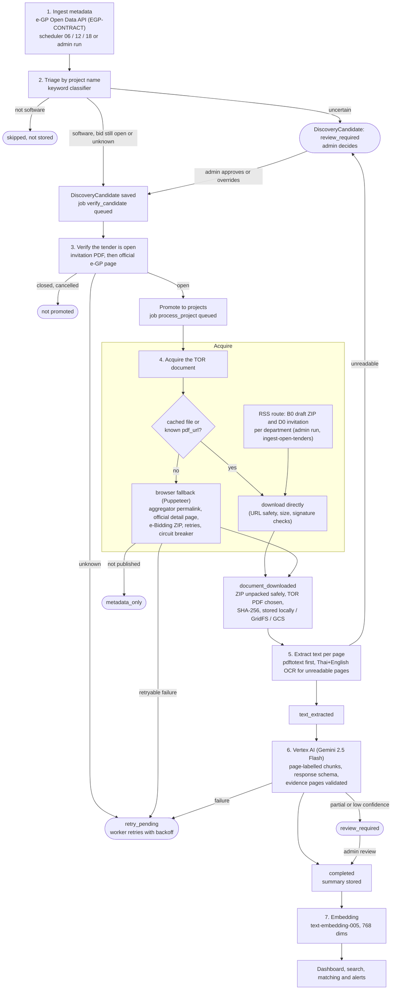

# TOR pull pipeline

Traces to: FR-1.1.1, FR-1.1.2, FR-1.2.1, FR-1.2.2, FR-2.1.1, FR-2.1.2, FR-2.3.1. See [traceability.md](traceability.md).

How a project becomes a summarised, searchable TOR. Each box is one stage; the label on a box is the `processing.status` the project has when that stage finishes. The step-by-step sequence with actors is in [tor-flow.md](tor-flow.md).



Stage 6 calls the configured AI provider. `AI_PROVIDER=vertex` is the primary path in `lib/vertex/tor-extractor.js`. When Vertex refuses the call and `AI_FALLBACK_PROVIDER=ollama`, that one request goes through the Ollama adapter (`lib/ai/ollama.js`), which the demo points at the [agy bridge](agy-bridge.md). Embeddings stay on Vertex and do not fall back (`lib/embedding-config.js`).


## How each step pulls its data

There are two ways in. The **API route** (steps 1 to 7 below) is the default: the scheduler and the worker use it. The **RSS route** reads the e-GP announcement feeds per department and is used by the admin run (`lib/services/pipeline-runner.js`) and `scripts/ingest-open-tenders.js`; it replaces steps 1 to 3 and step 4's browser work with feed links, then joins the same steps 5 to 7.

### 1. Ingest metadata

| | |
|---|---|
| Source | e-GP Open Data API, `https://opend.data.go.th/govspending/service/egp-contract` (`lib/egp-api.js`) |
| Trigger | the scheduler calls `POST /api/ingestion/trigger` at 06:00, 12:00 and 18:00 Asia/Bangkok with `PIPELINE_ADMIN_TOKEN`; admins and `npm run scheduler:once` call the same endpoint |
| Request | `GET ...?api-key=<EGP_API_KEY>&year=<Thai fiscal year>&limit=<n>&offset=<n>` plus optional `keyword` and `dept_code`; 20 s timeout; the key is redacted from error text |
| Paging | up to 1000 records per request, 500 records per run unless `limit` is given (max 1000); it keeps asking with a larger `offset` until it has enough or runs out |
| Year | the current Thai fiscal year (Buddhist Era; the year rolls over in October) unless `year` is sent |
| Mapping | dates such as `21 มิ.ย. 67` are parsed to UTC dates (BE minus 543); budget is `project_money`, falling back to `price_build`; a SHA-256 of the raw record is stored as `source.payload_hash` |
| Write | an upsert by `project_id` that refreshes metadata but never touches fields owned by processing or Vertex (`$setOnInsert` sets the initial `metadata_ingested` status) |
| Failure | HTTP 5xx and 429 are transient and the scheduler retries (about 5, 15 and 45 minutes with jitter); a missing key or a 4xx is not retried. An HTML 403 titled Access Denied that says "blocked by our security systems" (Cloudflare Ray ID) is `EGP_UPSTREAM_BLOCKED`: the edge refused this client before checking `EGP_API_KEY`, so rotating the key does not help. Point the `INGESTION_RUNNER` Actions variable at a self-hosted runner in Thailand. A JSON 401/403 that names the API key is `EGP_AUTH_FAILED` and does mean the secret should be rotated |

### 2. Triage by project name

The classifier (`lib/classifier.js`, `lib/classification.js`) counts software and non-software keywords in the project name. Keyword lists come from MongoDB (editable by admins through `/api/admin/keywords`) and fall back to built-in defaults.

- **software:** continues.
- **not software:** counted in `skipped.notSoftware` and not stored.
- **uncertain** (no keyword or a tie): stored as a `DiscoveryCandidate` with status `review_required` so a keyword list can never silently discard a relevant TOR. An admin decides through `/api/admin/classification`; a manual override is final and is never overwritten.
- Records that already show a contract or award, or a closed status, are skipped (`skipped.closed`).

### 3. Verify the tender is still open

Metadata alone never proves a bid is open. For each software candidate the ingest saves a `DiscoveryCandidate` and queues a `verify_candidate` job; the worker runs `verifyDiscoveryCandidate` (`lib/discovery-candidates.js`):

1. Re-run the classifier (or honour the admin override).
2. **Invitation (ประกาศเชิญชวน):** find the `D0` entry for the project in the department's RSS feed (`lib/project-announcement.js`: department ids come from `tender.rss_dept_id`, `source.rss_dept_id` or `EGP_RSS_DEPT_IDS`; at most 4 departments; one feed request per 4 s; cached 5 minutes), download the PDF, read the text (embedded first, OCR if needed) and parse the submission window, agency and reference price (`lib/announcement-schedule.js`, `lib/egp-announcement.js`).
3. **Official page:** resolve the project through the aggregator permalink `https://egp-gprocurement.com/p/<project_id>` to the official detail URL on `process5.gprocurement.go.th` (only that host and path are accepted, redirects are refused, the response is capped at 2 MB, requests are spaced 1 s apart), then read the labelled fields (status, bid submission end). If the plain HTML shows no answer, the page is rendered with Puppeteer.
4. `assessProcurementEligibility` turns that into `open`, `not_yet_open`, `closed` or `unknown`. A bid end without a time of day is **not** proof that bidding is open, and a draft status is `unknown`. A newer official extension or cancellation wins over an older invitation.
5. `open` promotes the candidate: the project is upserted with `procurement_eligibility`, `tender.invitation_url` and `tender.rss_dept_id`, a `process_project` job is queued, and the candidate becomes `promoted`. `closed` and `not_yet_open` stop here. `unknown` throws, so the job goes back to the queue with backoff.

### 4. Acquire the TOR document

`processProject` (`lib/processing-pipeline.js`) tries these in order and stops at the first that yields a file:

1. **Already stored:** the project's local file or primary document, if it exists and is not empty.
2. **Known URL:** `document.source_url` and `pdf_url`, checked by `validateRemoteDocumentUrl` and downloaded directly with no browser.
3. **Browser fallback** (`ENABLE_BROWSER_FALLBACK`, on by default), `scrapeProjectTOR` in `lib/scraper.js`:
   1. resolve the aggregator permalink to the official detail URL;
   2. open the official detail page in Puppeteer, wait for it to render, and reload up to a few times when the page comes back empty;
   3. find the e-Bidding row in the related-documents list and download the latest draft e-Bidding ZIP (an intermittent document-list endpoint is handled by reloading the page);
   4. if that fails, collect document links on the page (`.pdf`, `.zip`, `.rar`, `.doc`, `.docx`, `.xlsx` and download-style links), prefer PDF, then ZIP, and skip links that do not return a real document;
   5. if the project has no published document, the outcome is `document_not_published` and the project ends as `metadata_only`.

**RSS route:** `acquireTenderDocuments` (`lib/tender-acquisition.js`) downloads the `D0` invitation first, checks that bidding is open, then downloads the `B0` draft-document ZIP straight from the feed link. Only when the feed has no ZIP does it fall back to the browser.

**Download rules** (`downloadAttachment`, `lib/scraper.js`):

| Rule | Value |
|---|---|
| Allowed URLs | `http` or `https`, no embedded credentials, not `localhost`, `.local` or a private address (`lib/url-safety.js`) |
| Redirects | followed by hand, at most 5, each hop checked again; cookies, `Authorization` and `Referer` are dropped when the origin changes |
| Size | at most 250 MB (`TOR_MAX_FILE_SIZE_MB`) |
| Content check | the first bytes must match the type: `%PDF-`, ZIP, RAR or old Office; a mismatch rejects the file |
| Politeness | a delay of 3 to 60 seconds between browser projects (`SCRAPER_DELAY_MS`, default 4 s) |

**Failures and retries:** browser failures are retried after 15 s and 60 s, a hard 240 s deadline per project relaunches the browser, and five transient failures in a row pause the run for 2 minutes (circuit breaker). Anything classified as retryable becomes `retry_pending`; "not published" becomes `metadata_only`.

### 4b. Unpack and store

- **ZIP safety** (`lib/archive-extractor.js`): at most 200 entries, 100 MB per PDF, 200 MB extracted in total, compression ratio at most 200, encrypted entries and symlinks rejected, file names sanitised, and every extracted file must start with the PDF signature.
- **Choosing the TOR:** each PDF gets a score from its file name: draft bidding document / e-Bidding (+120), scope of work / terms of reference / "TOR" (+100), specification (+60), reference price / announcement / forms / appendices (-20), plus up to 20 for size in MB. The highest score is the primary document; the others are kept.
- **Store** (`lib/document-storage.js`): the file is hashed with SHA-256 and kept in the backend chosen by `TOR_STORAGE_BACKEND`: `local` (default), `gridfs` (MongoDB) or `gcs` (needs `TOR_GCS_BUCKET`, object name derived from the hash so re-uploads are idempotent). Status becomes `document_downloaded`.

### 5. Extract text

`extractPdfText` (`lib/text-extraction.js`) works one page at a time, from 1 to 1000 pages:

1. `pdftotext -layout` for the embedded text.
2. The page counts as readable only if it has at least 40 non-space characters, under 2% broken glyphs and more than half letters or digits (`usableText`).
3. Otherwise the page is rendered with `pdftoppm` (300 DPI by default, `OCR_DPI` 200 to 600, longest side capped by `OCR_MAX_DIMENSION`) and read with Tesseract `tha+eng` using TSV output.
4. A second Tesseract pass with another page-segmentation mode runs when the first result has low confidence, is unreadable, or contains money amounts, and the better candidate is kept. Amounts read by OCR are flagged `financial_ocr_requires_review`, and two passes that disagree on an amount add `ocr_amount_disagreement`.
5. Each page is checkpointed on disk, keyed by the PDF hash and the OCR settings, so a retry never repeats finished pages.

If the project's classification was still `uncertain`, it is re-run on the extracted text (method `ocr_keyword_classifier`). A document with no readable page ends as `review_required` (`document_unreadable`).

### 6. Summarise with Vertex AI

`extractTorWithVertex` (`lib/vertex/tor-extractor.js`):

1. `prepareReadablePages` drops lines and pages with broken fonts and records coverage: `complete`, `partial` or `unreadable`.
2. `chunkPages` groups pages into chunks of at most 24,000 characters, each page keeping its number; chunks are sent one after another.
3. Each request goes to `gemini-2.5-flash` (`VERTEX_MODEL`) at `GOOGLE_CLOUD_LOCATION`, with the instructions as the system prompt and the page text as JSON **data**; the prompt says document text is untrusted and must not be obeyed. Temperature 0.1, JSON output forced by a response schema, 300 s timeout (`VERTEX_TIMEOUT_MS`).
4. HTTP 429, 5xx and network errors are retried up to 4 times (`VERTEX_MAX_ATTEMPTS`, at most 5) with exponential backoff of 1 s doubling, plus jitter, capped at 30 s, and `Retry-After` is honoured.
5. Every chunk result is cached by a hash of its pages, the model and the prompt version (`VertexChunk`), so a retry reuses finished chunks.
6. Validation: every evidence page must exist in the chunk, fiscal-year evidence must be supported by the text of the page it cites, and clause quotes that the page does not contain become warnings.
7. Chunk results are merged without dropping evidence; duplicate risk findings are combined, keeping the higher severity.

It returns the Thai summary, qualifications, scope of work, tech stack, fiscal year and budget evidence, flagged clauses and risk findings (unrealistic tenure, excessive hardware, vendor lock-in, excessive team capacity), each with its page. The project becomes `completed` only when the text needed no review, coverage is complete and the fiscal budget is unambiguous; otherwise it is `review_required`. Authoritative e-GP metadata is never overwritten by the model.

### 7. Embed

`lib/vertex/embedding.js` builds one text from the project name, agency, summary, the first 10 scope items and the tech stack (at most 8,000 characters), and asks `text-embedding-005` for a 768-number vector in `us-central1` (`VERTEX_EMBEDDING_*`). The vector is stored in `projects.vectorEmbedding` with a hash of its source text. It runs right after a job completes; a failure is saved on the project and never fails the job, and the sweep retries after 10 minutes, up to 5 attempts. Details: [vector-search.md](vector-search.md).

## Where the data comes from

| Source | What it gives | Used for |
|---|---|---|
| e-GP Open Data API (`lib/egp-api.js`) | structured project metadata and a `pdf_url` when known | stage 1, stage 2 |
| e-GP announcement RSS, per department (`lib/egp-rss.js`) | `B0`: draft bidding documents (ZIP). `D0`: invitation announcement (PDF) | stages 3 and 4 (the invitation supplies the submission window, agency and reference price; the ZIP supplies the TOR) |
| Official e-GP detail page (Puppeteer) | the document when nothing above has it | stage 4, last resort |

## Jobs, retries and recovery

API requests never process a TOR themselves. They enqueue a job in the `processingjobs` collection and the worker (`scripts/worker.js`) picks it up.

| Rule | Value | Code |
|---|---|---|
| Claim | oldest queued job; the worker takes a **lease** of 10 minutes and the attempt counter goes up | `claimNextJob` in `lib/job-queue.js` |
| Attempts | up to 3 per job by default (`max_attempts`) | `lib/job-queue.js` |
| Retry backoff | 30 s, doubling each attempt, capped at 1 hour; a non-retryable error fails the job at once | `lib/job-queue.js` |
| Crashed worker | a `running` job whose lease has expired goes back to `queued` | `lib/job-queue.js` |
| Duplicate requests | a project that already has a queued or running job is not enqueued twice | `lib/job-queue.js` |
| Recovery sweep | plans which stuck projects to re-enqueue (skips summarised, terminal, not-software and manual-review projects) | `lib/processing-recovery.js` |
| Browser failures | retried with backoff; a circuit breaker pauses the run after repeated transient failures so an e-GP outage does not use up every attempt | `lib/tender-acquisition.js` |
| Scheduler | runs ingestion then scraping at 06:00, 12:00 and 18:00 Asia/Bangkok; each run is stored in `ingestionruns` | `scripts/ingestion-scheduler.js`, [reference.md](reference.md#automated-ingestion-schedule) |

## Statuses

`processing.status` (mirrored in `workflow.status`) tells you where a project is:

| Status | Meaning | Who moves it on |
|---|---|---|
| `irrelevant` | classified as not software | nobody (admin can override the classification) |
| `metadata_only` | tender closed or cancelled, or the document was never published | nobody |
| `review_required` | needs a human: uncertain classification, unknown eligibility, unreadable document, partial or low-confidence AI result | admin review queue (`/api/processing/review`, `/api/admin/classification`) |
| `retry_pending` | a retryable failure (network, e-GP 5xx, browser, Vertex) | the worker, with backoff |
| `document_downloaded`, `text_extraction_pending`, `text_extracted`, `ai_pending` | in progress between stages | the worker |
| `completed` | summary and evidence stored | done; the embedding sweep adds the vector |

Admins can start a run and watch its progress through `/api/admin/pipeline/trigger` and `/api/admin/pipeline/status`; these actions are recorded by `lib/admin-pipeline-audit.js`. Check progress with `GET /api/processing/status` and `GET /api/ingestion/status`.

## Trial on live e-GP (16 November 2026)

Run on a development machine with a local MongoDB (not Atlas) and Vertex turned off, so it covers steps 1 to 5.

| Step | What was run | Result |
|---|---|---|
| 1. Ingest | `POST /api/ingestion/trigger` with the default year | fiscal year 2570 returned **0 records**: it only began in October, so the contract dataset is empty |
| 1. Ingest | same, `year` 2569, `limit` 40 | 40 records in 8 s: 22 not software, 12 uncertain (saved as candidates), 6 already contracted. None was an open bid, because this dataset lists contracts |
| 3. Discover open bids | `ingest-open-tenders.js --depts=1507,2102,0703 --dry-run` | 51 open tenders, 1 software; the `B0` feeds of departments 2102 and 0703 timed out and the run carried on |
| 4. Acquire | same script on the software tender | invitation PDF stored and its window parsed (20 Nov 2026, 09:00 to 12:00); TOR taken **through the browser route** (aggregator, official page, e-Bidding ZIP, `12. TOR_software_Genomic.pdf` chosen) in about 9 s |
| 3 and 5. Worker | the queued `process_project` job | stopped at eligibility, see below |

**Finding.** The worker re-checks that bidding is open. When it reuses a stored schedule (less than 15 minutes old) it reads `submission_schedule.ends_at` from MongoDB, which is a `Date`, but `parseBidDeadline` only accepts strings. The project is then marked `unknown` ("No unambiguous bid closing timestamp") and ends as `review_required` although the deadline is 4 days away. Checked directly: `assessProcurementEligibility({ bid_deadline: '2026-11-20T05:00:00.000Z' })` is `open`, the same value as a `Date` is `unknown`. Text extraction and Vertex were therefore not reached for this tender.

## Run it

```bash
npm run scheduler:once                       # ingest now
curl -X POST localhost:3000/api/processing/trigger -H 'Content-Type: application/json' -d '{"batchSize":20}'
npm run worker:once                          # process one queued job
```

More options: [reference.md](reference.md#run-the-pipeline).
