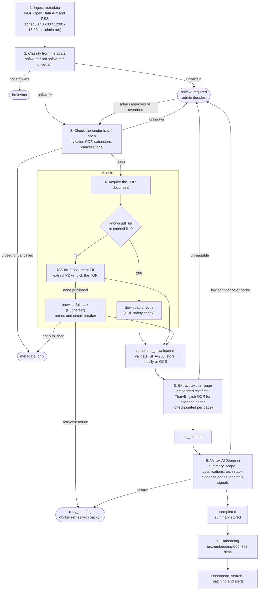

# TOR pull pipeline

How a project becomes a summarised, searchable TOR. Each box is one stage; the label on a box is the `processing.status` the project has when that stage finishes. The step-by-step sequence with actors is in [tor-flow.md](tor-flow.md).



## Stages

| # | Stage | Code | Notes |
|---|---|---|---|
| 1 | Ingest | `lib/egp-api.js`, `lib/egp-rss.js`, `lib/ingestion-runner.js` | Scheduler calls the trigger endpoints; each run is stored in `ingestionruns` |
| 2 | Classify | `lib/classifier.js`, `lib/classification.js` | Admin override in `lib/classification-override.js` |
| 3 | Eligibility | `lib/procurement-eligibility.js`, `lib/egp-announcement.js` | A newer extension or cancellation wins over the older invitation |
| 4 | Acquire | `lib/document-resolver.js`, `lib/tender-acquisition.js`, `lib/scraper.js` | API first, browser only as the last resort (`ENABLE_BROWSER_FALLBACK`) |
| 5 | Extract text | `lib/text-extraction.js` | Poppler (`pdftotext`, `pdftoppm`) and Tesseract `tha+eng`; PDFs up to 1000 pages |
| 6 | Summarise | `lib/vertex/` | Output must match the response schema; TOR text is data, not instructions |
| 7 | Embed | `lib/vertex/embedding.js`, `docs/vector-search.md` | Worker runs it after a job and a sweep retries failures |

Orchestration is `processProject` in `lib/processing-pipeline.js`. API requests only enqueue a job in MongoDB; `scripts/worker.js` runs jobs with leases and bounded retries, so a crashed worker never leaves a job stuck in `running`.

## Run it

```bash
npm run scheduler:once                       # ingest now
curl -X POST localhost:3000/api/processing/trigger -H 'Content-Type: application/json' -d '{"batchSize":20}'
npm run worker:once                          # process one queued job
```

More options: [reference.md](reference.md#run-the-pipeline).
