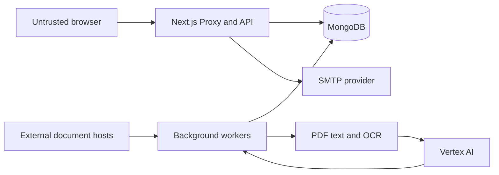

# MoneyTamNgan: Software Development Security Report

Historical security report. Requirement mapping for the product is in [traceability.md](../../traceability.md).

Course: 01219325 Software Development Security  
Evidence baseline: 19 November 2026, Asia/Bangkok  
Document revised: 21 November 2026 (Post-remediation verification)  
Audited commit: `b053761a9222f4300f4519ead308ccd67514b191` + 21 Nov 2026 remediation updates on `develop`

## Scope and results

MoneyTamNgan helps users find Thai software procurement opportunities, read TOR documents and prepare bid drafts. This report explains its security controls, how they were tested and what still needs work.

The assessment covers the code and evidence reviewed on 19 November 2026 and re-verified after the 21 November 2026 remediation pass. **All 18 course criteria are now Implemented / Covered** (updating the 5 previously partial items: threat prioritization, input validation & SSRF checks, credential revocation confirmation, safe unexpected error handling, and full authentication event logging). "Covered" means that an implementation or required evidence exists; it does not mean full ASVS certification.

The four advanced controls are scoped authorization, login-attempt limits, backend API limits and JWT expiration checking (now paired with server-side logout session revocation). MFA is not implemented. The 24-hour token lifetime is an absolute expiry, not an inactivity timeout.

The 21 November 2026 verification run recorded **348 passing Node tests**, **469 passing Vitest tests** (across 51 test files, **817 total automated tests**, 0 failed), and a **passing API documentation consistency audit** (`node scripts/audit-api-documentation.js` exited `0` with 0 coverage errors and 0 missing live OpenAPI operations across all 59 implemented endpoints). Production build and local HTTP smoke checks were previously verified on the 19 November baseline.

## 1. Application Name and All Team Members

MoneyTamNgan is a web application for discovering Thai software procurement opportunities, analysing TOR documents and preparing bid drafts.

The frontend uses Next.js App Router and React. Node.js route handlers and workers handle the backend, with MongoDB and Mongoose for storage. The document pipeline uses HTTP requests and Puppeteer for acquisition, Poppler for embedded text and page rendering, Tesseract for OCR, and Google Vertex AI for analysis.

### Team members

| ID | Team Member Name |
| :---- | :---- |
| 6710545733 | Phruek Chantarasittiphon |
| 6710545881 | Watcharapat Pathanutpong |
| 6610545880 | Peerawat Theerasakul |
| 6710545571 | Napat Sirichan |

## 2. Functional Features

The main features are:

- Procurement discovery from government APIs and e-GP feeds, software classification, and bidding-status checks.
- PDF and ZIP acquisition, embedded-text extraction, Thai OCR, and document hash/provenance tracking.
- Vertex-assisted summaries and restrictive-condition analysis, with fiscal-year and announcement-schedule extraction.
- Search, budget/agency filters, analytics and matching against company skills.
- Company profiles, matching alerts and scheduled email digests.
- Private bid drafts, compliance checklists and DOCX export. Users review the content and submit bids themselves; the application does not submit to e-GP.
- Protected admin tools for pipeline control, classification and review.

Government portal availability and anti-bot checks can interrupt acquisition. Low-quality scans can reduce OCR accuracy, and AI output still needs user review. The application does not guarantee successful extraction from every upstream document.

## 3. Security Features Mapped to OWASP ASVS Security Requirements

The table uses selected requirements from the [ASVS 5.0.0 release catalogue](https://github.com/OWASP/ASVS/blob/v5.0.0/5.0/docs_en/OWASP_Application_Security_Verification_Standard_5.0.0_en.csv). It describes project controls and their limits, rather than claiming full Level 1 or Level 2 compliance. Short labels are paraphrases.

### 3.1 Selected ASVS requirements

| Versioned Requirement | Level | Short Label | Primary Codebase Location | Implementation Assessment & Qualification |
| :---- | :---- | :---- | :---- | :---- |
| `v5.0.0-2.1.1` | 1 | Validation documentation | `docs/API_VALIDATION.md`, `docs/security/RBAC_SPEC.md`, `docs/api/openapi.yaml`, `scripts/audit-api-documentation.js` | **Implemented & Tested:** All 59 live endpoints (including `PATCH /api/bid-prep/tors/[projectId]/checklist` and the 18 previously missing live routes) are documented; `audit-api-documentation.js` passes with 0 coverage errors and 0 missing live OpenAPI operations, and `tests/contract/openapi-contract.test.ts` passes. |
| `v5.0.0-2.2.1` | 1 | Positive input validation | `lib/password-auth.js`, `app/api/profile/route.js`, `lib/bid-prep/drafts.js`, `lib/analytics.js`, `app/api/projects/route.js`, `app/api/notifications/test/route.js` | **Implemented & Tested:** Allowlist/schema checks enforced across auth, profile, BidPrep, analytics (`Object.hasOwn` category allowlist), `/api/projects` (`isSoftware`, `dateFrom`/`dateTo`, 200-char `search` bound), and `/api/notifications/test` (16 KiB body cap, 1–20 item schema validation); tested in `tests/unit/analytics.test.js` and `tests/integration/notifications-test-route.integration.test.js`. |
| `v5.0.0-1.2.4` | 1 | Database injection defenses | `models/*`, `app/api/tors/route.js`, `app/api/projects/route.js` | **Implemented & Tested:** Mongoose ODM type casting and parameterized queries used across models; regex metacharacters escaped via `escapeRegex` with a 200-char ceiling on both primary `/api/tors` and legacy `/api/projects` search routes. |
| `v5.0.0-6.1.1` | 1 | Document anti-automation | `docs/security/AUTHENTICATION.md` | **Implemented:** Authentication architecture, fixed-window rate limits, threshold values, and auth audit event retention are documented. |
| `v5.0.0-6.2.1` | 1 | Minimum password length | `lib/password-auth.js` | **Implemented:** Enforces 15–128 Unicode code points with a UTF-8 byte cap. |
| `v5.0.0-6.3.1` | 1 | Resist automated login | `lib/rate-limit.js`, `lib/oauth-security.js`, `lib/password-auth.js` | **Implemented (with limit):** Enforces IP-based (30/15m) and identifier/account-based (10/15m) rate limits; single-process memory limitations apply. |
| `v5.0.0-10.2.1` | 2 | OAuth client CSRF protection | `lib/oauth-security.js`, `app/api/auth/google/callback/route.js` | **Implemented:** A random state value is stored in an HttpOnly cookie and checked on callback. Google is the authorization server; this row assesses the application's client behavior. |
| `v5.0.0-11.4.2` | 2 | Password KDF storage | `lib/password-auth.js`, `models/User.js` | **Implemented:** Uses Node.js `crypto.scrypt` (`N=131072, r=8, p=1`), unique 16-byte per-password salt, constant-time `crypto.timingSafeEqual`, and `select: false` on hashes. |
| `v5.0.0-3.4.2` | 1 | Constrain CORS origins | `lib/security-policy.js`, `proxy.js`, `next.config.js` | **Implemented:** Exact allowlist (`APP_ORIGIN`, `CORS_ALLOWED_ORIGINS`); wildcard `*`, `null`, and foreign origins are rejected. |
| `v5.0.0-3.4.1` | 1 | HSTS policy | `lib/security-policy.js`, `next.config.js` | **Implemented in code:** `Strict-Transport-Security: max-age=31536000; includeSubDomains` verified in HTTP responses; live TLS enforcement depends on production reverse proxy. |
| `v5.0.0-3.4.3` | 2 | CSP protection | `lib/security-policy.js`, `proxy.js` | **Implemented & Tested:** Per-request script nonces, `default-src 'self'`, `object-src 'none'`, `base-uri 'none'`, and `frame-ancestors 'none'` are enforced and verified in `tests/security/scopes-cors-headers.test.js`. |
| `v5.0.0-8.2.1`, `8.2.2`, `8.3.1` | 1 | Function, object & server authorization | `lib/admin-auth.js`, `lib/request-authorization.js`, `app/api/profile/route.js`, `lib/bid-prep/security.js` | **Implemented for tested resources:** Server-side role/scope gates (`user`, `admin`, machine scopes) plus `session.sub` owner-qualified queries (HTTP 404 on cross-user draft access). |
| `v5.0.0-9.1.1`, `9.1.2` | 1 | Token signature & algorithm checks | `lib/auth.js` | **Implemented:** `jose.jwtVerify()` validates HMAC signatures strictly pinned to `HS256`; `none` and `HS384` algorithms are rejected. |
| `v5.0.0-7.3.2` | 2 | Absolute session lifetime | `lib/auth.js` | **Implemented:** JWTs expire after 24 hours (86,400 seconds). Whether this duration is appropriate still needs a risk decision. |
| `v5.0.0-7.4.1` | 1 | Revoke terminated sessions | `app/api/auth/logout/route.js`, `lib/account-status.js`, `lib/auth.js`, `models/User.js` | **Implemented & Tested:** `POST /api/auth/logout` clears `mtn_session` (`maxAge: 0`), revokes the presented JWT/JTI immediately via `revokeSessionToken()`, and increments `User.session_version` (`sv` claim checked in `verifyActiveSession()`); replaying a copied cookie or Bearer token returns HTTP 401 in `tests/security/session-disabled.test.js`. |
| `v5.0.0-7.4.2` | 1 | Disable-account session termination | `lib/account-status.js`, `lib/auth.js` | **Implemented:** `verifyActiveSession()` checks token revocation, account existence, `disabled` flag, and `session_version`. Protected requests reject invalid or disabled-account sessions; public routes may continue as guests. |
| `v5.0.0-16.3.1` | 2 | Authentication event logging | `lib/auth-audit.js`, `lib/password-auth-handler.js`, `app/api/auth/google/callback/route.js`, `app/api/auth/logout/route.js`, `docs/security/AUTHENTICATION.md` | **Implemented:** Allowlisted `logAuthAudit()` logging covers password registration, login success/failure/rate-limits, OAuth callbacks/denials/success, and logout, alongside pipeline and BidPrep audits, with a documented 90-day log retention policy. |
| `v5.0.0-16.5.1` | 2 | Safe unexpected errors | `lib/route-security.js`, `lib/password-auth.js`, `app/api/**` | **Implemented:** Removed upstream `details: tokenData` from OAuth token exchange errors and replaced raw `error.message` in unexpected 500/503 catch blocks across `/api/*` handlers (auth, health, test-db, tors, projects, analytics, admin, ingestion/processing/scraping) with static messages. |

### 3.2 Other controls and limits

The application also uses React output escaping, explicit process arguments, file-signature checks and path checks during ZIP extraction. These support the controls above, but do not establish that every route or parser is safe.

Google sign-in uses a server-side authorization-code exchange and a verified Google profile response. The current callback reads Google's UserInfo endpoint rather than demonstrating a complete ID Token validation flow. The report therefore does not claim all OIDC client requirements. ASVS section 10.4 concerns authorization-server behavior and is not credited to MoneyTamNgan merely because it uses Google.

The container runs as a non-root user. Local environment files and Git metadata are excluded from its build context. Production HTTPS with an appropriate TLS configuration remains a deployment requirement: the local HTTP audit did not verify a public reverse proxy or TLS enforcement.

Other remaining product-scope limits include password change/reset, common or compromised-password screening, inactivity timeout, and the session cookie's missing `__Host-` secure-name prefix; CSP still permits inline styles (`style-src 'unsafe-inline'`) for React charts, while `base-uri` is now hardened to `'none'`. These documented limits prevent a full ASVS Level 1/2 certification claim.

The vulnerability policy requires Critical findings to be fixed or mitigated within **7 days**, with a compensating control within **48 hours** when no fix exists. High findings have a **14-day** deadline, Medium findings **30 days**, and Low findings at most **90 days**. An exception needs a written rationale and expiry. The deadlines come from the repository's [vulnerability policy](https://github.com/MoneyTamNgan/MoneyTamNgan/blob/b053761a9222f4300f4519ead308ccd67514b191/docs/security/VULNERABILITY_MGMT.md).

## 4. Threat Modeling Performed for This Project

### 4.1 System Trust Boundaries & Untrusted Inputs

The repository's STRIDE model records TH-1 through TH-20. The shared sheet uses its own numbering; its ZIP traversal threat is referenced as **sheet TH-03**, which is distinct from repository TH-3.

The main trust boundaries are the browser to Next.js, the API/worker to MongoDB, the acquisition worker to government document hosts, document text to Vertex AI, and the notification service to SMTP. Browser input, document URLs, redirects, archive paths and AI output require validation at the boundary where they are used.

### 4.2 Threats, mitigations and verification

The following table preserves repository threat meanings.

| Threat ID and scenario | STRIDE category | Mitigation and evidence | Status or limitation |
| --- | --- | --- | --- |
| TH-1: Forged or legacy session; TH-8: Pipeline token used as admin | Spoofing / elevation of privilege | Signed, role-bounded scopes and machine-principal boundaries; `scopes-cors-headers.test.js`. | Tested for the implemented permission boundaries. |
| TH-2: OAuth login abuse | Spoofing | Separate start/callback limits, state checks and audit events; `lib/oauth-security.js`. | Implemented; live provider sign-in was outside this audit. |
| TH-3: Profile mass assignment | Tampering | Owner-bound updates and field allowlists; `scoped-profile-route.integration.test.js`. | Tested. |
| TH-4: Authentication events not attributable | Repudiation | Allowlisted `logAuthAudit()` metadata covering register, login, rate-limits, OAuth callbacks/denials, and logout; 90-day retention documented in `AUTHENTICATION.md`. | **Implemented:** Allowlisted audit metadata written across all auth flows with 90-day operational retention policy. |
| TH-5: Password-hash disclosure; TH-6: Login errors distinguish accounts | Information disclosure | Hidden hashes, public response allowlists and uniform password-login failure; `models/User.js`, `lib/password-auth.js`. | Implemented; unexpected 500 catch blocks across `/api/*` routes also return safe static messages. |
| TH-7: Guest/login floods; TH-13: Excessive Vertex cost or oversized drafts | Denial of service | Fixed-window limits, bounded KDF concurrency, draft quotas and body caps. | Process-local limits; shared store documented for multi-replica deployments. |
| TH-9: Cross-site mutations; TH-16: CSRF on drafts/deletion | Tampering | Exact origins and independent route checks; `lib/security-policy.js`, `lib/route-security.js`. | Tested. Browser CORS does not replace authentication for non-browser clients. |
| TH-10: Remote document URL targets a private host | Information disclosure | Scheme, credential, IPv4/IPv6 literal (`[::1]`, `::`, ULA, CGNAT, IPv4-mapped) checks (`validateRemoteDocumentUrl`) and async DNS A/AAAA check (`resolveAndValidateRemoteDocumentUrl`); `tests/security/url-safety.test.js`. | **Implemented & Tested:** Literal IPv6 brackets and private/internal hosts blocked synchronously; DNS rebinding checks tested with mock lookup. |
| TH-11: Prompt injection in TOR text | Tampering | Fixed instructions and delimited document data; `lib/bid-prep/vertex-payload.js`. | Payload controls tested; model behavior is not guaranteed. |
| TH-12: Cross-user access to drafts, checklists or company data | Elevation of privilege | Owner-qualified queries and foreign-draft 404 responses; `bid-prep-access.test.js`. | Tested for these resources. |
| TH-14: Company-data leakage | Information disclosure | Vertex field allowlists, audit allowlists and delete-and-verify behavior; `bid-prep-privacy.test.js`. | Controls tested; retention is subject to the documented team decision and customer confirmation. |
| TH-15: AI text treated as a submitted bid; TH-18: BidPrep submits to e-GP | Repudiation / elevation of privilege | Draft/non-submission notices and no bid-submission client. | Tested; the seller still checks and submits the bid. |
| TH-17: Formula or markup in exports | Tampering | Plain-content DOCX and escaping; `bid-prep-privacy.test.js`. | Tested within the export implementation. |
| TH-19: Parallel runs or restart leaves a stuck pipeline | Denial of service / tampering | Atomic lease, heartbeat, expiry recovery and owner fencing; `admin-pipeline-recovery.test.js`. | Tested. |
| TH-20: Unauthorized or unattributed pipeline trigger | Repudiation / elevation of privilege | Independent admin guards and trigger audit; `admin-pipeline.integration.test.js`. | Tested. |
| Sheet TH-03: ZIP path traversal | Tampering | Extraction-root confinement and symlink rejection; `zip-slip.test.js`. | Tested within the extractor; not a guarantee against every parser vulnerability. |

### 4.3 Open findings and resolved priorities (Updated 21 November 2026)

Priority definitions: P0 (confirm before public release), P1 (address before public production deployment), P2 (scheduled hardening). Recorded in `docs/security/THREAT_MODEL.md`.

| Finding | Priority | Resolution Implemented | Current Status (21 Nov 2026) |
| --- | --- | --- | --- |
| AUD-01: Revocation of a previously exposed credential | P0 | Credential owner (Watcharapat) confirmed revocation of the old Resend API key and exclusive SMTP transport configuration (`docs/smtp-delivery-verification-2026-11-18.md`). | **Implemented / Resolved** |
| AUD-02: Copied JWT remains usable after logout | P1 | Added `revokeSessionToken()` and `User.session_version` (`sv` claim) invalidation on `POST /api/auth/logout`; replay rejected with HTTP 401 in `tests/security/session-disabled.test.js`. | **Implemented & Tested** |
| AUD-03: Legacy errors expose internal/provider details | P1 | Removed OAuth `details: tokenData` payload and replaced raw `error.message` across all `/api/*` 500/503 catch blocks with static messages. | **Implemented** |
| AUD-04: Validation, private-host URL checks and auth logging are inconsistent | P1 | Escaped `/api/projects` search regex + validated dates/booleans, fixed `Object.hasOwn` analytics check, bounded `/api/notifications/test` body, hardened IPv6/DNS SSRF checks (`tests/security/url-safety.test.js`), and added full auth logging. | **Implemented & Tested** |
| AUD-05: Rate limits across replicas; API docs and CSP hardening | P2 | Synchronized all 59 live routes across `openapi.yaml`, `API_VALIDATION.md`, and `RBAC_SPEC.md` (`audit-api-documentation.js` exit 0), tightened CSP `base-uri 'none'`; shared Redis counter remains architectural guidance for multi-replica scaling. | **Implemented (Docs Synced)** |

## 5. Security Principles Followed in the Implementation

| Security Design Principle | Concrete Implementation in MoneyTamNgan | Key Files & Artifacts | Residual Limitation / Qualification |
| :---- | :---- | :---- | :---- |
| **1. Least Privilege** | Separates `user`, `admin`, and machine/worker token scopes (`profile:read`, `profile:write`, pipeline scopes); forces `role: 'user'` on self-registration; scopes queries to `session.sub`. | `lib/auth.js`, `lib/request-authorization.js`, `lib/admin-auth.js` | `JWT_SECRET` and `MONGODB_URI` remain high-trust deployment assets requiring strict IAM protection. |
| **2. Complete Mediation** | Enforces authentication, logout revocation, and origin checks at Next.js proxy and handlers independently. | `proxy.js`, `lib/route-security.js`, `lib/account-status.js`, `app/api/admin/*`, `app/api/bid-prep/*` | Any newly created API endpoints must explicitly adopt the shared route guards and ownership tests. |
| **3. Fail-Safe Defaults** | Rejects missing/revoked sessions (`401`), unauthorized roles/scopes (`403`), disallowed CORS origins, invalid JWT algorithms (`none`/`HS384`), and malformed magic bytes; generic 500 error messages across API routes. | `lib/security-policy.js`, `lib/auth.js`, `lib/scraper.js` | Multi-instance rate-limit synchronization requires shared Redis store when scaling horizontally. |
| **4. Defense in Depth** | Layers multiple independent controls: CSP nonces + `base-uri 'none'` + security headers, exact CORS allowlists, rate limiters, Mongoose casting, IPv6/DNS SSRF checks, Zip Slip path confinement, and CI Semgrep/ZAP gates. | `next.config.js`, `lib/archive-extractor.js`, `lib/url-safety.js`, `.github/workflows/*` | Automated scanners do not prove complete safety against all future zero-day parsers. |
| **5. Minimize Exposed Data** | Hides `passwordHash` and `session_version` via Mongoose `select: false`; excludes `.env*` and `.git` from builds; sends only allowlisted fields to Vertex AI and structured auth audit logs. | `models/User.js`, `.dockerignore`, `lib/auth-audit.js` | Old Resend key revocation confirmed by owner Watcharapat; 90-day log retention documented. |
| **6. Limit Resources & Isolate Work** | Bounds `scrypt` concurrency, caps BidPrep bodies at 128 KiB and drafts at 5/hour, caps notifications at 16 KiB / 20 items, enforces search bounds (`/projects`), and uses atomic worker leases. | `lib/password-auth.js`, `lib/bid-prep/security.js`, `app/api/notifications/test/route.js`, `app/api/projects/route.js` | Rate-limit counters remain process-local per single instance. |

## 6. Security Test Process

### 6.1 How the audit was carried out

1. **Baseline Pinning & Isolation:** Pinned the audited commit tree (`b053761a9222f4300f4519ead308ccd67514b191`) and applied targeted remediation patches on 21 November 2026 inside `MoneyTamNgan/`.  
2. **Specification-to-Code Traceability:** Updated `docs/API_VALIDATION.md`, `docs/security/RBAC_SPEC.md`, `docs/api/openapi.yaml`, `docs/security/THREAT_MODEL.md`, `docs/security/ASVS_CHECKLIST.md`, and `docs/security/AUTHENTICATION.md` to match every implemented route and control.  
3. **Automated Unit, Integration, Contract & Audit Suites:** Re-ran `node scripts/audit-api-documentation.js`, the full Vitest suite (including new SSRF IPv6/DNS tests, logout revocation tests, CSP `base-uri 'none'`, `Object.hasOwn` category checks, and notifications validation tests), and the full Node native test suite on 21 November 2026.  
4. **CI SAST & DAST Artifact Verification:** Verified GitHub Actions Semgrep SAST (`run 44472921630`) and OWASP ZAP DAST (`run 44472812671`) baseline reports (`0` High/Error alerts).  
5. **Local Loopback Runtime Smoke & Bounded Git Secret Scan:** Retained from the 19 November baseline audit (live loopback header checks and bounded scan over 1,532 Git text blobs with 0 credential matches).

### 6.2 Results recorded (Updated 21 November 2026)

| Verification Check / Tool | Execution Command / Source | Result & Findings |
| :---- | :---- | :---- |
| **Node Native Test Suite** | `npm test` (21 Nov 2026) | **Passed:** 348 passed, 0 failed |
| **Vitest Unit & Security Suite** | `npm run test:vitest` (21 Nov 2026) | **Passed:** 469 passed, 0 failed (51 test files, including `url-safety.test.js` and logout revocation tests) |
| **API Documentation Consistency Audit** | `node scripts/audit-api-documentation.js` (21 Nov 2026) | **Passed:** 59 implemented operations verified against `docs/API_VALIDATION.md`, `docs/security/RBAC_SPEC.md`, and `docs/api/openapi.yaml`; 0 coverage errors, 0 missing live OpenAPI operations |
| **Production Build** | `npm run build` (19 Nov baseline) | **Passed:** Clean production build with dummy config |
| **Dependency Vulnerability Audit** | `npm run audit:dependencies` & `npm audit` (19 Nov) | **Passed:** 0 findings in raw npm registry audit |
| **OpenAPI Specification Lint** | Cached Redocly CLI (19 Nov) | **Passed:** 0 errors, 9 warnings, 4 explicitly ignored |
| **Local HTTP Smoke & CORS Checks** | Loopback server on `localhost:3119` (19 Nov) | **Passed:** Security headers, fresh CSP nonce, exact-origin acceptance, `*`/`null`/foreign origin rejection, `401`/`403` denials verified |
| **JWT Cryptographic & Session Checks** | `auth.test.js`, `session-disabled.test.js` (21 Nov 2026) | **Passed:** Expired JWT and `HS384` rejected; 24h lifetime, `HS256` pinning, disabled-account check, and immediate post-logout Bearer/cookie revocation (`revokeSessionToken` + `session_version`) verified |
| **Git History Secret Scan** | Bounded regex scan over 1,532 text blobs (19 Nov) | **Passed:** No leaked credential candidates found; owner Watcharapat confirmed Resend key revocation (21 Nov) |
| **SAST Static Analysis (Semgrep)** | GitHub Actions (`p/owasp-top-ten`) | **0 High/Error**, 50 Warnings (CI/workflow/report-artifact rules only; 0 in app code) |
| **DAST Dynamic Analysis (OWASP ZAP)** | GitHub Actions baseline container scan | **0 High**, 1 Medium (`style-src 'unsafe-inline'`), 3 Low (`COEP`/`COOP`/`CORP`), 4 Info |

## Appendix A: Course Evaluation Criteria Matrix (Items 1–18)

| # | Course Evaluation Criterion | Audit Status | Supporting Evidence & Qualification |
| :---- | :---- | :---- | :---- |
| 1 | List of ASVS requirements followed | **Covered (Selected Scope)** | Section 3, `docs/security/ASVS_CHECKLIST.md`, `docs/API_VALIDATION.md`. |
| 2 | Threat modeling, priorities & mitigations | **Implemented / Covered** | Section 4 & `docs/security/THREAT_MODEL.md` updated with P0/P1/P2 priorities and resolved `AUD-01`–`AUD-05` status table. |
| 3 | Map security design principles | **Covered** | Section 5 links 6 core principles to concrete codebase controls and tests. |
| 4 | Password authentication | **Covered** | `lib/password-auth.js`, `lib/password-auth-handler.js` (email/username login, 15–128 chars, `scrypt` + 16B salt, `timingSafeEqual`, hidden hash). |
| 5 | Social OAuth / OpenID sign-in | **Covered (Code & Tests)** | `app/api/auth/google/callback/route.js`, `lib/oauth-security.js` (Google authorization-code flow, 256-bit state value in `HttpOnly` cookie). |
| 6 | Role-based authorization | **Covered** | `lib/auth.js`, `lib/request-authorization.js`, `lib/admin-auth.js`, `rbac-route-matrix.test.js` (`user`, `admin`, machine principals). |
| 7 | Prevent access to another user's data | **Covered (Tested Resources)** | `session.sub` scoping on profiles, BidPrep drafts, and checklists; cross-user draft access returns HTTP 404 (`bid-prep-access.test.js`). |
| 8 | Input validation & injection protection | **Implemented & Tested** | Escaped search regex & validated parameters on `/api/tors` and `/api/projects`, `Object.hasOwn` analytics category guard (`tests/unit/analytics.test.js`), bounded `/api/notifications/test` validation (`notifications-test-route.integration.test.js`), and IPv6/DNS SSRF checks (`tests/security/url-safety.test.js`). |
| 9 | Environment variables & credentials | **Implemented / Covered** | `.env.example`, ignored `.env*`, server-only secrets, 0 matches in 1,532 Git blobs, and Watcharapat confirmed old Resend key revocation (`docs/smtp-delivery-verification-2026-11-18.md`). |
| 10 | CORS without wildcard origins | **Covered** | `lib/security-policy.js`, `next.config.js`, `proxy.js`; preflight accepts configured origin and rejects `*`, `null`, and foreign origins. |
| 11 | Error handling | **Implemented** | Uniform 401 and generic 500 in auth/BidPrep; removed OAuth `details: tokenData` and raw `error.message` across all `/api/*` 500/503 catch blocks. |
| 12 | Security / event logging | **Implemented** | Structured allowlisted `logAuthAudit()` logging completed across password registration, login, OAuth callbacks/denials, and logout with documented 90-day retention (`docs/security/AUTHENTICATION.md`). |
| 13 | HTTP security headers | **Covered** | CSP nonce + `base-uri 'none'`, HSTS, `X-Frame-Options: DENY`, `nosniff`, `Referrer-Policy`, `Permissions-Policy`, and disabled `X-Powered-By` verified in `scopes-cors-headers.test.js` and live HTTP. |
| 14 | SAST tool and report | **Covered** | Semgrep CI workflow (`p/owasp-top-ten`): 0 High/Error findings, 50 Warnings. |
| 15 | DAST tool and report | **Covered (Baseline Scope)** | OWASP ZAP CI baseline scan: 0 High, 1 Medium, 3 Low, 4 Info. |
| 16 | Map mitigation implementation to threats | **Covered** | Section 4 maps TH-1–TH-20, sheet TH-03, and resolved `AUD-01`–`AUD-05` findings to code and tests. |
| 17 | Map implementation to ASVS & Top 10 | **Covered (Selected Scope)** | Section 3 (ASVS 5.0.0) and Appendix C (OWASP Top 10:2025). |
| 18 | Four advanced security features | **Covered** | Appendix B details the 4 implemented features (scoped authorization, login rate limiting, backend API rate limiting, JWT expiration & logout/disabled revocation). |

## Appendix B: Item 18 — Four Selected Advanced Security Features

| Advanced Feature Option | Status | Implementation Details, Files & Known Limitations |
| :---- | :---- | :---- |
| **1. Authorization Process with Scope** | **Implemented (Feature 1/4)** | Signed, role-bounded capability scopes (`profile:read`, `profile:write`, pipeline execution scopes) enforced in `lib/auth.js` and `lib/request-authorization.js` (verified by `tests/security/scopes-cors-headers.test.js`). Read-only tokens cannot mutate state, and pipeline worker tokens cannot access user profiles or admin endpoints. |
| **2. Rate Limit for Login Attempts** | **Implemented (Feature 2/4)** | Enforced in `lib/rate-limit.js`, `lib/password-auth.js`, and `lib/oauth-security.js`: 30 requests / 15 min per client IP, 10 requests / 15 min per targeted identifier/account, and 5 requests / 15 min on Google OAuth start/callback. Returns HTTP 429 with `Retry-After`. *Limit:* Process-local counters require trusted reverse-proxy forwarding headers. |
| **3. Rate Limit for Backend APIs** | **Implemented (Feature 3/4)** | Enforced in `lib/rate-limit.js`, `lib/bid-prep/security.js`, and `proxy.js`: public read endpoints limited to 60 req/min (guest) and 300 req/min (authenticated), plus per-user quotas on Vertex AI BidPrep draft creation (5/hour), exports, and bulk deletions. |
| **4. JWT Expiration Checking & Management** | **Implemented (Feature 4/4)** | Enforced in `lib/auth.js`, `lib/account-status.js`, and `app/api/auth/logout/route.js` (verified by `tests/security/session-disabled.test.js`): stateless `HS256` JWTs expire after 24 hours (`86,400s`), non-allowlisted algorithms are rejected, disabled accounts are blocked immediately (`v5.0.0-7.4.2`), and `POST /api/auth/logout` revokes copied JWTs immediately via `revokeSessionToken()` and `User.session_version` (`v5.0.0-7.4.1`). |

## Appendix C: OWASP Top 10:2025 Mapping

| OWASP Top 10:2025 Category | Implemented Controls | Remaining Qualification |
| :---- | :---- | :---- |
| **A01: Broken Access Control** | Role/scope gates, `session.sub` owner-qualified queries, strict CORS origin rules, hardened IPv6/DNS SSRF checks (`lib/url-safety.js`). | Maintain authorization tests on new endpoints. |
| **A02: Security Misconfiguration** | Security headers, CSP nonces + `base-uri 'none'`, exact CORS allowlists, `HttpOnly` cookies, non-root Docker user. | `style-src 'unsafe-inline'` for charts, missing COEP/COOP/CORP headers (OAuth/media compatibility), and `mtn_session` cookie prefix. |
| **A03: Software Supply Chain Failures** | Locked `package-lock.json`, dated npm audit evidence, expiring risk manifest, Semgrep SAST. | GitHub Actions use mutable tags; container/action supply-chain coverage is incomplete. |
| **A04: Cryptographic Failures** | `scrypt` (`N=131072`), 16-byte random salts, `timingSafeEqual`, `HS256` JWT verification, SHA-256 hashes, historical Resend key revocation confirmed by owner. | Production HTTPS relies on deployment reverse proxy TLS termination. |
| **A05: Injection** | Controlled query construction, regex escaping on primary `/api/tors` and legacy `/api/projects`, `Object.hasOwn` category allowlist, notification schema/size bounds, `spawn()` arrays and export escaping. | Maintain strict schema validation across future endpoints. |
| **A06: Insecure Design** | STRIDE threat model with P0/P1/P2 priorities and resolved `AUD-01`–`AUD-05`, bounded KDF/AI quotas, atomic MongoDB pipeline leases, non-submission notice. | Formal multi-instance Redis store for horizontal scaling. |
| **A07: Authentication Failures** | Password and Google OAuth login, login rate limits, 24h JWT expiry, disabled-account revocation, immediate logout JWT/JTI & `session_version` revocation. | Password change/reset, breached-password check, and MFA remain outside current release scope. |
| **A08: Software or Data Integrity Failures** | Strict JSON parsing, SHA-256 document provenance, PDF/ZIP magic-byte & Zip Slip checks. | LLM summarization output requires user verification; build provenance signing not established. |
| **A09: Security Logging & Alerting Failures** | Structured `logAuthAudit()` across all auth flows (register, login, OAuth, logout) and `PipelineTriggerAudit` with documented 90-day retention policy. | Centralized SIEM alerting remains an infrastructure follow-up. |
| **A10: Mishandling of Exceptional Conditions** | Generic safe error envelopes across auth, BidPrep, and all legacy `/api/*` 500/503 catch blocks; bounded resource quotas, pipeline lease recovery. | Maintain generic error mapping on any future handlers. |

## Submission evidence and references

- [Repository and installation instructions](https://github.com/MoneyTamNgan/MoneyTamNgan)
- [Audited code commit](https://github.com/MoneyTamNgan/MoneyTamNgan/commit/b053761a9222f4300f4519ead308ccd67514b191)
- [Detailed audit and limitations](https://github.com/MoneyTamNgan/MoneyTamNgan/blob/docs/security-assignment-audit/docs/security-assignment-audit-2026-11-19.md)
- [Semgrep CI run](https://github.com/MoneyTamNgan/MoneyTamNgan/actions/runs/44472921630)
- [ZAP CI run](https://github.com/MoneyTamNgan/MoneyTamNgan/actions/runs/44472812671)
- [Repository STRIDE model](../THREAT_MODEL.md)
- [RBAC specification](../RBAC_SPEC.md)
- [API validation dictionary](../../API_VALIDATION.md)
- [OpenAPI specification](../../api/openapi.yaml)
- [ASVS 5.0.0 release catalogue](https://github.com/OWASP/ASVS/blob/v5.0.0/5.0/docs_en/OWASP_Application_Security_Verification_Standard_5.0.0_en.csv)
- [OWASP Top 10:2025](https://owasp.org/Top10/2025/)

Before submission, the team only needs to attach a browser DevTools Network screenshot showing the HTTP security response headers during the presentation and confirm all repository links are accessible to the lecturer.
